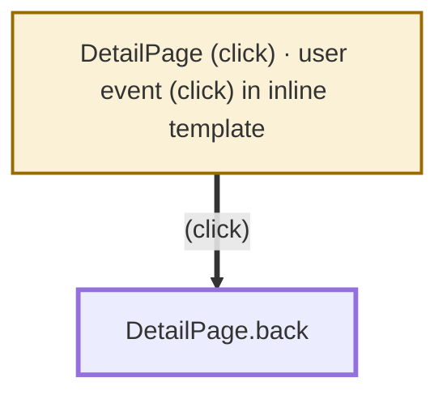

# How execution reaches DetailPage.back

Target `src/app/pages/detail.page.ts:60` — `back(): void`. 1 root, 2 nodes, 1 edges (Angular 20.1.3, @ionic/angular 8.4.3). Generated by execmap; edges point toward the target.

| Mark | Meaning |
|---|---|
| 🟥 red | Angular hook (`ngOnInit`, `ngAfterViewInit`, …) |
| 🟦 blue | Ionic page hook (`ionViewWillEnter`, …) |
| 🟨 amber | Router guard or resolver |
| 🟨 thick amber border | Root: where execution starts (framework hook, user event, route, module init) |
| ⬛ thick border | The target |
| ⏳ | The framework awaits what this hook returns; navigation pauses until it settles |
| ┄ dashed | Cycle: this edge leads back into the chain |

## Roots

- **DetailPage (click)** — dom: user event (click) in inline template; awaited: no; instance: exists; per docs; runs inside NgZone when Angular is present; change detection follows
