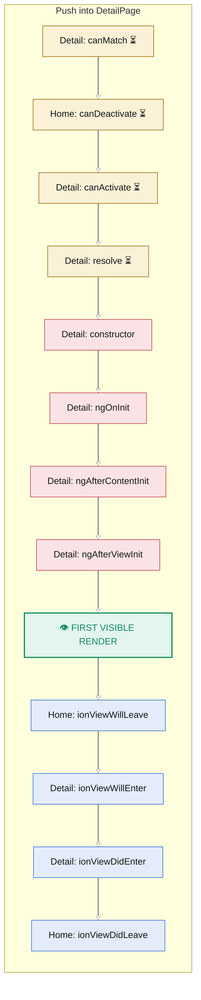

# DetailPage lifecycle: Push into DetailPage

Profile `ionic-angular` · measured on @ionic/angular 8.4.3. Only hooks the page implements and guards on its route are shown; change-detection passes are left out. ⏳ = the framework awaits what you return.

| # | Page | Hook | Kind | Awaited | Implemented by | Note |
|---|---|---|---|---|---|---|
| 1 | Detail | `canMatch` | guard | ⏳ promise|observable | makeCanMatch | doc-derived |
| 2 | Home | `canDeactivate` | guard | ⏳ promise|observable | makeCanDeactivate |  |
| 3 | Detail | `canActivate` | guard | ⏳ promise|observable | makeCanActivate |  |
| 4 | Detail | `resolve` | guard | ⏳ promise|observable | makeResolve |  |
| 5 | Detail | `constructor` | angular |  | DetailPage |  |
| 6 | Detail | `ngOnInit` | angular |  | DetailPage |  |
| 7 | Detail | `ngAfterContentInit` | angular |  | DetailPage |  |
| 8 | Detail | `ngAfterViewInit` | angular |  | DetailPage |  |
| 9 | App | 👁 first visible render | paint |  |  |  |
| 10 | Home | `ionViewWillLeave` | ionic |  | HomePage |  |
| 11 | Detail | `ionViewWillEnter` | ionic |  | DetailPage |  |
| 12 | Detail | `ionViewDidEnter` | ionic |  | DetailPage |  |
| 13 | Home | `ionViewDidLeave` | ionic |  | HomePage |  |

## Notes

- Leaving HomePage (inferred from navigation calls; pass --from to override).
- DetailPage declares `ionViewCanEnter`, `ionViewCanLeave`, `ionViewWillLoad`, `ionViewDidLoad`, `ionViewWillUnload`: removed in Ionic 4+, never called unless a compat base class re-emits them (ionViewWillLoad from ngOnInit, ionViewDidLoad from ngAfterViewInit, ionViewWillUnload from ngOnDestroy) or a route guard forwards to them (legacyCanEnter -> static ionViewCanEnter, legacyCanLeave -> ionViewCanLeave).
