# Ionic 3 → Ionic 8 page lifecycle order comparison

Generated 2026-11-13T14:31:24.149Z by `tools/generate.mjs`.
Phases: **boot** (first load until Home settles), **forward** (Home → Detail), **back** (Detail → Home).
Consecutive identical events are collapsed to `×N`; repeated change-detection cycles are collapsed to `CD cycle ×N` after their first occurrence.

## Versions and captures

| Capture | Versions | URL | Captured at | Log entries |
|---|---|---|---|---|
| Old (`old`) | Ionic 3.9.5 / Angular 5.0.3 | http://localhost:8100 | 2026-11-13T13:17:06.795Z | 192 |
| New (`new`) | Ionic 8.4.3 / Angular 20.1.3 | http://localhost:4200/home | 2026-11-13T13:17:10.075Z | 285 |
| New + compat shim (`new-compat`) | Ionic 8.4.3 / Angular 20.1.3 + compat shim | http://localhost:4200/home?compat=1 | 2026-11-13T13:17:13.290Z | 293 |

Node colors in the diagrams follow the log `source`: angular (blue), ionic (orange), ionic-app (green), ionic-compat (violet), router (yellow), guard (pink), render (dark green), cd (grey).

## Phase: boot

| App | Raw events | Collapsed rows | Duration |
|---|---|---|---|
| Old | 55 | 50 | 770.4 ms |
| New | 65 | 51 | 933.4 ms |
| New + compat shim | 68 | 54 | 933.1 ms |

### boot: flow

```mermaid
flowchart TD
  classDef src_angular fill:#dbe8fb,stroke:#2a78d6,color:#111
  classDef src_ionic fill:#ffe1d4,stroke:#eb6834,color:#111
  classDef src_ionic_app fill:#dcf3e8,stroke:#1baf7a,color:#111
  classDef src_ionic_compat fill:#e8e3fb,stroke:#4a3aa7,color:#111
  classDef src_router fill:#fff1c7,stroke:#eda100,color:#111
  classDef src_guard fill:#fde0ea,stroke:#e87ba4,color:#111
  classDef src_render fill:#e2f0d9,stroke:#008300,color:#111
  classDef src_cd fill:#eeeeea,stroke:#898781,color:#111
  subgraph OG["Old — Ionic 3.9.5 / Angular 5.0.3"]
    direction TB
    O0["App · main.ts"]:::src_angular
    O1["App · AppComponent.constructor"]:::src_angular
    O2["Home · constructor"]:::src_angular
    O3["Home · ionViewCanEnter"]:::src_ionic
    O4["App · AppRef.tick"]:::src_cd
    O5["Home · ionViewCanEnter (resolved)"]:::src_ionic
    O6["Home · ionViewWillLoad"]:::src_ionic
    O7["Home · ngOnInit"]:::src_angular
    O8["Home · ngDoCheck"]:::src_angular
    O9["Home · ngAfterContentInit"]:::src_angular
    O10["Home · ngAfterContentChecked"]:::src_angular
    O11["Home · directive:ngOnInit"]:::src_render
    O12["Home · template-evaluated"]:::src_cd
    O13["Home · directive:ngAfterViewInit"]:::src_render
    O14["Home · ngAfterViewInit"]:::src_angular
    O15["Home · ngAfterViewChecked"]:::src_angular
    O16["Home · ionViewDidLoad"]:::src_ionic
    O17["App · app.viewDidLoad"]:::src_ionic_app
    O18["App · AppRef.tick"]:::src_cd
    O19["Home · ngDoCheck"]:::src_angular
    O20["Home · ngAfterContentChecked"]:::src_angular
    O21["Home · template-evaluated"]:::src_cd
    O22["Home · ngAfterViewChecked"]:::src_angular
    O23["Home · template-evaluated"]:::src_cd
    O24["Mixed · CD cycle"]:::src_cd
    O25["Home · rAF-after-viewInit"]:::src_render
    O26["App · AppRef.tick"]:::src_cd
    O27["Home · ngDoCheck"]:::src_angular
    O28["Home · ngAfterContentChecked"]:::src_angular
    O29["Home · template-evaluated"]:::src_cd
    O30["Home · ngAfterViewChecked"]:::src_angular
    O31["Home · template-evaluated"]:::src_cd
    O32["Home · viewCtrl.readReady"]:::src_render
    O33["Home · ionViewWillEnter"]:::src_ionic
    O34["App · app.viewWillEnter"]:::src_ionic_app
    O35["App · AppRef.tick"]:::src_cd
    O36["Home · ngDoCheck"]:::src_angular
    O37["Home · ngAfterContentChecked"]:::src_angular
    O38["Home · template-evaluated"]:::src_cd
    O39["Home · ngAfterViewChecked"]:::src_angular
    O40["Home · template-evaluated"]:::src_cd
    O41["Home · viewCtrl.writeReady"]:::src_render
    O42["Home · ionViewDidEnter"]:::src_ionic
    O43["App · app.viewDidEnter"]:::src_ionic_app
    O44["App · AppRef.tick"]:::src_cd
    O45["Home · ngDoCheck"]:::src_angular
    O46["Home · ngAfterContentChecked"]:::src_angular
    O47["Home · template-evaluated"]:::src_cd
    O48["Home · ngAfterViewChecked"]:::src_angular
    O49["Home · template-evaluated"]:::src_cd
    O0 --> O1
    O1 --> O2
    O2 --> O3
    O3 --> O4
    O4 --> O5
    O5 --> O6
    O6 --> O7
    O7 --> O8
    O8 --> O9
    O9 --> O10
    O10 --> O11
    O11 --> O12
    O12 --> O13
    O13 --> O14
    O14 --> O15
    O15 --> O16
    O16 --> O17
    O17 --> O18
    O18 --> O19
    O19 --> O20
    O20 --> O21
    O21 --> O22
    O22 --> O23
    O23 --> O24
    O24 --> O25
    O25 --> O26
    O26 --> O27
    O27 --> O28
    O28 --> O29
    O29 --> O30
    O30 --> O31
    O31 --> O32
    O32 --> O33
    O33 --> O34
    O34 --> O35
    O35 --> O36
    O36 --> O37
    O37 --> O38
    O38 --> O39
    O39 --> O40
    O40 --> O41
    O41 --> O42
    O42 --> O43
    O43 --> O44
    O44 --> O45
    O45 --> O46
    O46 --> O47
    O47 --> O48
    O48 --> O49
  end
  subgraph NG["New — Ionic 8.4.3 / Angular 20.1.3"]
    direction TB
    N0["App · main.ts"]:::src_angular
    N1["App · AppComponent.constructor"]:::src_angular
    N2["App · AppRef.tick"]:::src_cd
    N3["App · NavigationStart"]:::src_router
    N4["Home · canMatch"]:::src_guard
    N5["App · AppRef.tick ×2"]:::src_cd
    N6["Home · canMatch (resolved)"]:::src_guard
    N7["App · RoutesRecognized"]:::src_router
    N8["App · GuardsCheckStart"]:::src_router
    N9["App · ActivationStart"]:::src_router
    N10["Home · canActivate"]:::src_guard
    N11["App · AppRef.tick"]:::src_cd
    N12["Home · canActivate (resolved)"]:::src_guard
    N13["App · GuardsCheckEnd"]:::src_router
    N14["App · ResolveStart"]:::src_router
    N15["Home · resolve"]:::src_guard
    N16["App · AppRef.tick"]:::src_cd
    N17["Home · resolve (resolved)"]:::src_guard
    N18["App · ResolveEnd"]:::src_router
    N19["Home · constructor"]:::src_angular
    N20["Home · ngOnInit"]:::src_angular
    N21["Home · ngDoCheck"]:::src_angular
    N22["Home · ngAfterContentInit"]:::src_angular
    N23["Home · ngAfterContentChecked"]:::src_angular
    N24["Home · directive:ngOnInit"]:::src_render
    N25["Home · template-evaluated"]:::src_cd
    N26["Home · directive:ngAfterViewInit"]:::src_render
    N27["Home · ngAfterViewInit"]:::src_angular
    N28["Home · ngAfterViewChecked"]:::src_angular
    N29["App · ActivationEnd"]:::src_router
    N30["App · NavigationEnd"]:::src_router
    N31["App · ionNavWillChange"]:::src_ionic_app
    N32["Home · ionViewWillEnter"]:::src_ionic
    N33["Home · ionViewDidEnter"]:::src_ionic
    N34["App · ionNavDidChange"]:::src_ionic_app
    N35["App · AppRef.tick"]:::src_cd
    N36["Home · ngDoCheck"]:::src_angular
    N37["Home · ngAfterContentChecked"]:::src_angular
    N38["Home · template-evaluated"]:::src_cd
    N39["Home · ngAfterViewChecked"]:::src_angular
    N40["Home · afterNextRender"]:::src_render
    N41["Home · afterEveryRender"]:::src_render
    N42["Home · template-evaluated"]:::src_cd
    N43["App · AppRef.tick"]:::src_cd
    N44["Home · ngDoCheck"]:::src_angular
    N45["Home · ngAfterContentChecked"]:::src_angular
    N46["Home · template-evaluated"]:::src_cd
    N47["Home · ngAfterViewChecked"]:::src_angular
    N48["Mixed · CD cycle ×2"]:::src_cd
    N49["Home · afterEveryRender"]:::src_render
    N50["Home · template-evaluated"]:::src_cd
    N0 --> N1
    N1 --> N2
    N2 --> N3
    N3 --> N4
    N4 --> N5
    N5 --> N6
    N6 --> N7
    N7 --> N8
    N8 --> N9
    N9 --> N10
    N10 --> N11
    N11 --> N12
    N12 --> N13
    N13 --> N14
    N14 --> N15
    N15 --> N16
    N16 --> N17
    N17 --> N18
    N18 --> N19
    N19 --> N20
    N20 --> N21
    N21 --> N22
    N22 --> N23
    N23 --> N24
    N24 --> N25
    N25 --> N26
    N26 --> N27
    N27 --> N28
    N28 --> N29
    N29 --> N30
    N30 --> N31
    N31 --> N32
    N32 --> N33
    N33 --> N34
    N34 --> N35
    N35 --> N36
    N36 --> N37
    N37 --> N38
    N38 --> N39
    N39 --> N40
    N40 --> N41
    N41 --> N42
    N42 --> N43
    N43 --> N44
    N44 --> N45
    N45 --> N46
    N46 --> N47
    N47 --> N48
    N48 --> N49
    N49 --> N50
  end
  subgraph CG["New + compat shim — Ionic 8.4.3 / Angular 20.1.3 + compat shim"]
    direction TB
    C0["App · main.ts"]:::src_angular
    C1["App · AppComponent.constructor"]:::src_angular
    C2["App · AppRef.tick"]:::src_cd
    C3["App · NavigationStart"]:::src_router
    C4["Home · canMatch"]:::src_guard
    C5["App · AppRef.tick ×2"]:::src_cd
    C6["Home · canMatch (resolved)"]:::src_guard
    C7["App · RoutesRecognized"]:::src_router
    C8["App · GuardsCheckStart"]:::src_router
    C9["App · ActivationStart"]:::src_router
    C10["Home · ionViewCanEnter"]:::src_ionic_compat
    C11["Home · ionViewCanEnter"]:::src_ionic_compat
    C12["App · AppRef.tick"]:::src_cd
    C13["Home · ionViewCanEnter (resolved)"]:::src_ionic_compat
    C14["App · GuardsCheckEnd"]:::src_router
    C15["App · ResolveStart"]:::src_router
    C16["Home · resolve"]:::src_guard
    C17["App · AppRef.tick"]:::src_cd
    C18["Home · resolve (resolved)"]:::src_guard
    C19["App · ResolveEnd"]:::src_router
    C20["Home · constructor"]:::src_angular
    C21["Home · ngOnInit"]:::src_angular
    C22["Home · ionViewWillLoad"]:::src_ionic_compat
    C23["Home · ngDoCheck"]:::src_angular
    C24["Home · ngAfterContentInit"]:::src_angular
    C25["Home · ngAfterContentChecked"]:::src_angular
    C26["Home · directive:ngOnInit"]:::src_render
    C27["Home · template-evaluated"]:::src_cd
    C28["Home · directive:ngAfterViewInit"]:::src_render
    C29["Home · ngAfterViewInit"]:::src_angular
    C30["Home · ionViewDidLoad"]:::src_ionic_compat
    C31["Home · ngAfterViewChecked"]:::src_angular
    C32["App · ActivationEnd"]:::src_router
    C33["App · NavigationEnd"]:::src_router
    C34["App · ionNavWillChange"]:::src_ionic_app
    C35["Home · ionViewWillEnter"]:::src_ionic_compat
    C36["Home · ionViewDidEnter"]:::src_ionic_compat
    C37["App · ionNavDidChange"]:::src_ionic_app
    C38["App · AppRef.tick"]:::src_cd
    C39["Home · ngDoCheck"]:::src_angular
    C40["Home · ngAfterContentChecked"]:::src_angular
    C41["Home · template-evaluated"]:::src_cd
    C42["Home · ngAfterViewChecked"]:::src_angular
    C43["Home · afterNextRender"]:::src_render
    C44["Home · afterEveryRender"]:::src_render
    C45["Home · template-evaluated"]:::src_cd
    C46["App · AppRef.tick"]:::src_cd
    C47["Home · ngDoCheck"]:::src_angular
    C48["Home · ngAfterContentChecked"]:::src_angular
    C49["Home · template-evaluated"]:::src_cd
    C50["Home · ngAfterViewChecked"]:::src_angular
    C51["Mixed · CD cycle ×2"]:::src_cd
    C52["Home · afterEveryRender"]:::src_render
    C53["Home · template-evaluated"]:::src_cd
    C0 --> C1
    C1 --> C2
    C2 --> C3
    C3 --> C4
    C4 --> C5
    C5 --> C6
    C6 --> C7
    C7 --> C8
    C8 --> C9
    C9 --> C10
    C10 --> C11
    C11 --> C12
    C12 --> C13
    C13 --> C14
    C14 --> C15
    C15 --> C16
    C16 --> C17
    C17 --> C18
    C18 --> C19
    C19 --> C20
    C20 --> C21
    C21 --> C22
    C22 --> C23
    C23 --> C24
    C24 --> C25
    C25 --> C26
    C26 --> C27
    C27 --> C28
    C28 --> C29
    C29 --> C30
    C30 --> C31
    C31 --> C32
    C32 --> C33
    C33 --> C34
    C34 --> C35
    C35 --> C36
    C36 --> C37
    C37 --> C38
    C38 --> C39
    C39 --> C40
    C40 --> C41
    C41 --> C42
    C42 --> C43
    C43 --> C44
    C44 --> C45
    C45 --> C46
    C46 --> C47
    C47 --> C48
    C48 --> C49
    C49 --> C50
    C50 --> C51
    C51 --> C52
    C52 --> C53
  end
```

### boot: side by side (collapsed events, row i = i-th event)

| # | Old | New | New + compat shim |
|---|---|---|---|
| 1 | App · main.ts +34.5 ms | App · main.ts +193.2 ms | App · main.ts +194.0 ms |
| 2 | App · AppComponent.constructor +91.7 ms | App · AppComponent.constructor +197.7 ms | App · AppComponent.constructor +198.7 ms |
| 3 | Home · constructor +93.3 ms | App · AppRef.tick +200.5 ms | App · AppRef.tick +201.5 ms |
| 4 | Home · ionViewCanEnter +94.1 ms | App · NavigationStart _(/home)_ +201.8 ms | App · NavigationStart _(/home?compat=1)_ +202.8 ms |
| 5 | App · AppRef.tick +94.3 ms | Home · canMatch +202.8 ms | Home · canMatch +203.8 ms |
| 6 | Home · ionViewCanEnter (resolved) _(resolved(true))_ +94.9 ms | App · AppRef.tick ×2 +203.3 ms | App · AppRef.tick ×2 +204.3 ms |
| 7 | Home · ionViewWillLoad +95.1 ms | Home · canMatch (resolved) _(resolved(true))_ +209.7 ms | Home · canMatch (resolved) _(resolved(true))_ +210.7 ms |
| 8 | Home · ngOnInit +95.2 ms | App · RoutesRecognized _(/home)_ +210.2 ms | App · RoutesRecognized _(/home?compat=1)_ +211.1 ms |
| 9 | Home · ngDoCheck +95.3 ms | App · GuardsCheckStart _(/home)_ +210.5 ms | App · GuardsCheckStart _(/home?compat=1)_ +211.4 ms |
| 10 | Home · ngAfterContentInit +95.3 ms | App · ActivationStart _(home)_ +210.8 ms | App · ActivationStart _(home)_ +211.8 ms |
| 11 | Home · ngAfterContentChecked +95.4 ms | Home · canActivate +211.1 ms | Home · ionViewCanEnter _(static (no instance exists yet))_ +212.0 ms |
| 12 | Home · directive:ngOnInit +95.4 ms | App · AppRef.tick +211.4 ms | Home · ionViewCanEnter +212.3 ms |
| 13 | Home · template-evaluated +95.6 ms | Home · canActivate (resolved) _(resolved(true))_ +211.8 ms | App · AppRef.tick +212.5 ms |
| 14 | Home · directive:ngAfterViewInit +96.1 ms | App · GuardsCheckEnd _(/home)_ +211.9 ms | Home · ionViewCanEnter (resolved) _(resolved(true))_ +212.9 ms |
| 15 | Home · ngAfterViewInit +96.1 ms | App · ResolveStart _(/home)_ +212.0 ms | App · GuardsCheckEnd _(/home?compat=1)_ +213.0 ms |
| 16 | Home · ngAfterViewChecked +96.1 ms | Home · resolve +212.3 ms | App · ResolveStart _(/home?compat=1)_ +213.2 ms |
| 17 | Home · ionViewDidLoad +96.1 ms | App · AppRef.tick +212.5 ms | Home · resolve +213.5 ms |
| 18 | App · app.viewDidLoad _(HomePage)_ +96.2 ms | Home · resolve (resolved) _(resolved(true))_ +213.0 ms | App · AppRef.tick +213.6 ms |
| 19 | App · AppRef.tick +96.6 ms | App · ResolveEnd _(/home)_ +213.1 ms | Home · resolve (resolved) _(resolved(true))_ +214.2 ms |
| 20 | Home · ngDoCheck +96.6 ms | Home · constructor +214.0 ms | App · ResolveEnd _(/home?compat=1)_ +214.3 ms |
| 21 | Home · ngAfterContentChecked +96.7 ms | Home · ngOnInit +216.2 ms | Home · constructor +215.2 ms |
| 22 | Home · template-evaluated +96.7 ms | Home · ngDoCheck +216.4 ms | Home · ngOnInit +217.3 ms |
| 23 | Home · ngAfterViewChecked +96.8 ms | Home · ngAfterContentInit +216.6 ms | Home · ionViewWillLoad +217.6 ms |
| 24 | Home · template-evaluated +96.8 ms | Home · ngAfterContentChecked +216.7 ms | Home · ngDoCheck +217.7 ms |
| 25 | Mixed · CD cycle _(App.AppRef.tick → Home.ngDoCheck → Home.ngAfterContentChecked → Home.template-evaluated → Home.ngAfterViewChecked → Home.template-evaluated)_ +97.1 ms | Home · directive:ngOnInit +216.9 ms | Home · ngAfterContentInit +217.9 ms |
| 26 | Home · rAF-after-viewInit +108.5 ms | Home · template-evaluated +217.1 ms | Home · ngAfterContentChecked +218.0 ms |
| 27 | App · AppRef.tick +108.5 ms | Home · directive:ngAfterViewInit +217.3 ms | Home · directive:ngOnInit +218.2 ms |
| 28 | Home · ngDoCheck +108.6 ms | Home · ngAfterViewInit +217.5 ms | Home · template-evaluated +218.4 ms |
| 29 | Home · ngAfterContentChecked +108.7 ms | Home · ngAfterViewChecked +217.6 ms | Home · directive:ngAfterViewInit +218.6 ms |
| 30 | Home · template-evaluated +108.7 ms | App · ActivationEnd _(home)_ +217.8 ms | Home · ngAfterViewInit +218.8 ms |
| 31 | Home · ngAfterViewChecked +108.8 ms | App · NavigationEnd _(/home)_ +218.0 ms | Home · ionViewDidLoad +218.9 ms |
| 32 | Home · template-evaluated +108.8 ms | App · ionNavWillChange +218.4 ms | Home · ngAfterViewChecked +219.0 ms |
| 33 | Home · viewCtrl.readReady +122.7 ms | Home · ionViewWillEnter +219.9 ms | App · ActivationEnd _(home)_ +219.3 ms |
| 34 | Home · ionViewWillEnter +122.9 ms | Home · ionViewDidEnter +220.0 ms | App · NavigationEnd _(/home?compat=1)_ +219.5 ms |
| 35 | App · app.viewWillEnter _(HomePage)_ +123.1 ms | App · ionNavDidChange +220.1 ms | App · ionNavWillChange +219.9 ms |
| 36 | App · AppRef.tick +123.1 ms | App · AppRef.tick +220.2 ms | Home · ionViewWillEnter +224.6 ms |
| 37 | Home · ngDoCheck +123.1 ms | Home · ngDoCheck +220.2 ms | Home · ionViewDidEnter +224.7 ms |
| 38 | Home · ngAfterContentChecked +123.1 ms | Home · ngAfterContentChecked +220.3 ms | App · ionNavDidChange +224.8 ms |
| 39 | Home · template-evaluated +123.2 ms | Home · template-evaluated +220.4 ms | App · AppRef.tick +225.0 ms |
| 40 | Home · ngAfterViewChecked +123.2 ms | Home · ngAfterViewChecked +220.5 ms | Home · ngDoCheck +225.0 ms |
| 41 | Home · template-evaluated +123.3 ms | Home · afterNextRender +220.6 ms | Home · ngAfterContentChecked +225.1 ms |
| 42 | Home · viewCtrl.writeReady +123.4 ms | Home · afterEveryRender +220.6 ms | Home · template-evaluated +225.2 ms |
| 43 | Home · ionViewDidEnter +123.6 ms | Home · template-evaluated +220.7 ms | Home · ngAfterViewChecked +225.2 ms |
| 44 | App · app.viewDidEnter _(HomePage)_ +123.7 ms | App · AppRef.tick +220.9 ms | Home · afterNextRender +225.3 ms |
| 45 | App · AppRef.tick +123.9 ms | Home · ngDoCheck +220.9 ms | Home · afterEveryRender +225.4 ms |
| 46 | Home · ngDoCheck +124.0 ms | Home · ngAfterContentChecked +220.9 ms | Home · template-evaluated +225.4 ms |
| 47 | Home · ngAfterContentChecked +124.0 ms | Home · template-evaluated +221.0 ms | App · AppRef.tick +225.5 ms |
| 48 | Home · template-evaluated +124.1 ms | Home · ngAfterViewChecked +221.0 ms | Home · ngDoCheck +225.6 ms |
| 49 | Home · ngAfterViewChecked +124.1 ms | Mixed · CD cycle ×2 _(Home.afterEveryRender → Home.template-evaluated → App.AppRef.tick → Home.ngDoCheck → Home.ngAfterContentChecked → Home.template-evaluated → Home.ngAfterViewChecked)_ +221.1 ms | Home · ngAfterContentChecked +225.7 ms |
| 50 | Home · template-evaluated +124.2 ms | Home · afterEveryRender +235.0 ms | Home · template-evaluated +225.7 ms |
| 51 |  | Home · template-evaluated +235.0 ms | Home · ngAfterViewChecked +225.8 ms |
| 52 |  |  | Mixed · CD cycle ×2 _(Home.afterEveryRender → Home.template-evaluated → App.AppRef.tick → Home.ngDoCheck → Home.ngAfterContentChecked → Home.template-evaluated → Home.ngAfterViewChecked)_ +225.9 ms |
| 53 |  |  | Home · afterEveryRender +236.6 ms |
| 54 |  |  | Home · template-evaluated +236.7 ms |

### boot: hook mapping and observed order

Positions are first-occurrence ordinals among the hooks of that page in that phase. "same order" means the relative order against the other mapped hooks of the page is unchanged.

| Old hook | New equivalent | Page | Old # | New # | Compat # (hook) | Verdict | Compat verdict | Note |
|---|---|---|---|---|---|---|---|---|
| `ionViewCanEnter` | `canActivate` | Home | #2 | #2 | #2 (`ionViewCanEnter`) | = same order | = same order | Router guard. Runs BEFORE the component exists; Ionic 3 constructed the component first (_viewInit) and then asked the instance. |
| `ionViewWillLoad` | `ngOnInit` | Home | #3 | #5 | #6 (`ionViewWillLoad`) | = same order | ↓ later | Fired right before the first change detection in Ionic 3; ngOnInit is the first hook of that same pass. |
| `ionViewDidLoad` | `ngOnInit` / `ngAfterViewInit` | Home | #13 | #5 | #14 (`ionViewDidLoad`) | ↑ earlier | = same order | Ionic docs say ngOnInit. Ionic 3 fired it after the first detectChanges (i.e. after ngAfterViewInit), so ngAfterViewInit is the closer match for "view exists" work. |
| `ionViewWillEnter` | `ionViewWillEnter` | Home | #16 | #14 | #16 (`ionViewWillEnter`) | = same order | = same order | Same name. Dispatched by ion-router-outlet before the transition. |
| `ionViewDidEnter` | `ionViewDidEnter` | Home | #18 | #15 | #17 (`ionViewDidEnter`) | = same order | = same order | Same name. Dispatched after the transition completes. |
| `app.viewDidLoad` | `ionNavWillChange` | App | #4 | #13 | #13 (`ionNavWillChange`) | = same order | = same order | App-level view emitters are gone; ion-router-outlet emits ionNavWillChange/ionNavDidChange, or subscribe to Router.events. |
| `app.viewWillEnter` | `ionNavWillChange` | App | #5 | #13 | #13 (`ionNavWillChange`) | = same order | = same order | See app.viewDidLoad. |
| `app.viewDidEnter` | `ionNavDidChange` | App | #6 | #14 | #14 (`ionNavDidChange`) | = same order | = same order | See app.viewDidLoad. |
| `app.viewWillLeave` | `ionNavWillChange` | App | – | #13 | #13 (`ionNavWillChange`) | + new only | + new only | See app.viewDidLoad. |
| `app.viewDidLeave` | `ionNavDidChange` | App | – | #14 | #14 (`ionNavDidChange`) | + new only | + new only | See app.viewDidLoad. |
| `app.viewWillUnload` | `NavigationEnd` | App | – | #12 | #12 (`NavigationEnd`) | + new only | + new only | No equivalent emitter; the closest router signal is NavigationEnd (the leaving view is destroyed after the transition). |
| — | `resolve` | Home | – | #3 | #3 (`resolve`) | + new only | + new only | No equivalent in Ionic 3: data loading was done in the constructor or ionViewDidLoad. Runs before the component exists. |
| — | `canMatch` | Home | – | #1 | #1 (`canMatch`) | + new only | + new only | New-only: route matching guard, runs during URL recognition. |
| — | `NavigationStart` | App | – | #4 | #4 (`NavigationStart`) | + new only | + new only | New-only router event (Router.events). |
| — | `NavigationEnd` | App | – | #12 | #12 (`NavigationEnd`) | + new only | + new only | New-only router event; fires before the Ionic transition starts. |
| `rAF-after-viewInit` | `afterNextRender` | Home | #14 | #16 | #18 (`afterNextRender`) | ↓ later | ↓ later | Ionic 3 apps approximated "after first paint" with requestAnimationFrame; Angular 16+ offers afterNextRender. |
| `constructor` | `constructor` | Home | #1 | #4 | #4 (`constructor`) | ↓ later | ↓ later | Same. Note that in the new app the guards and resolvers run before it. |
| `ngOnInit` | `ngOnInit` | Home | #4 | #5 | #5 (`ngOnInit`) | = same order | = same order | Same name. |
| `ngDoCheck` | `ngDoCheck` | Home | #5 | #6 | #7 (`ngDoCheck`) | = same order | = same order | Same name. |
| `ngAfterContentInit` | `ngAfterContentInit` | Home | #6 | #7 | #8 (`ngAfterContentInit`) | = same order | = same order | Same name. |
| `ngAfterContentChecked` | `ngAfterContentChecked` | Home | #7 | #8 | #9 (`ngAfterContentChecked`) | = same order | = same order | Same name. |
| `ngAfterViewInit` | `ngAfterViewInit` | Home | #11 | #12 | #13 (`ngAfterViewInit`) | = same order | = same order | Same name. |
| `ngAfterViewChecked` | `ngAfterViewChecked` | Home | #12 | #13 | #15 (`ngAfterViewChecked`) | = same order | ↓ later | Same name. |
| `template-evaluated` | `template-evaluated` | Home | #9 | #10 | #11 (`template-evaluated`) | = same order | = same order | Template binding evaluated. ViewEngine runs directive hooks before text bindings; Ivy interleaves them in template order. |
| `directive:ngOnInit` | `directive:ngOnInit` | Home | #8 | #9 | #10 (`directive:ngOnInit`) | = same order | = same order | Same name (logRender directive on ion-content). |
| `directive:ngAfterViewInit` | `directive:ngAfterViewInit` | Home | #10 | #11 | #12 (`directive:ngAfterViewInit`) | = same order | = same order | Same name. |

## Phase: forward

| App | Raw events | Collapsed rows | Duration |
|---|---|---|---|
| Old | 80 | 80 | 1011.9 ms |
| New | 111 | 96 | 1063.1 ms |
| New + compat shim | 114 | 99 | 1065.9 ms |

### forward: flow

_Compact diagram: Old has 80 collapsed rows, New has 96 collapsed rows, New + compat shim has 99 collapsed rows (limit 60 per column), so every change-detection run is folded into one `CD pass ×ticks` node here. The side-by-side table below keeps the first pass of each run expanded._

```mermaid
flowchart TD
  classDef src_angular fill:#dbe8fb,stroke:#2a78d6,color:#111
  classDef src_ionic fill:#ffe1d4,stroke:#eb6834,color:#111
  classDef src_ionic_app fill:#dcf3e8,stroke:#1baf7a,color:#111
  classDef src_ionic_compat fill:#e8e3fb,stroke:#4a3aa7,color:#111
  classDef src_router fill:#fff1c7,stroke:#eda100,color:#111
  classDef src_guard fill:#fde0ea,stroke:#e87ba4,color:#111
  classDef src_render fill:#e2f0d9,stroke:#008300,color:#111
  classDef src_cd fill:#eeeeea,stroke:#898781,color:#111
  subgraph OG["Old — Ionic 3.9.5 / Angular 5.0.3"]
    direction TB
    O0["Home · nav.push"]:::src_ionic
    O1["Detail · constructor"]:::src_angular
    O2["Home · ionViewCanLeave"]:::src_ionic
    O3["Detail · ionViewCanEnter"]:::src_ionic
    O4["Mixed · CD pass"]:::src_cd
    O5["Home · ionViewCanLeave (resolved)"]:::src_ionic
    O6["Mixed · CD pass"]:::src_cd
    O7["Detail · ionViewCanEnter (resolved)"]:::src_ionic
    O8["Detail · ionViewWillLoad"]:::src_ionic
    O9["Detail · ngOnInit"]:::src_angular
    O10["Detail · CD pass"]:::src_cd
    O11["Detail · ngAfterContentInit"]:::src_angular
    O12["Detail · CD pass"]:::src_cd
    O13["Detail · directive:ngOnInit"]:::src_render
    O14["Detail · CD pass"]:::src_cd
    O15["Detail · directive:ngAfterViewInit"]:::src_render
    O16["Detail · ngAfterViewInit"]:::src_angular
    O17["Detail · CD pass"]:::src_cd
    O18["Detail · ionViewDidLoad"]:::src_ionic
    O19["App · app.viewDidLoad"]:::src_ionic_app
    O20["Mixed · CD pass"]:::src_cd
    O21["Detail · rAF-after-viewInit"]:::src_render
    O22["Mixed · CD pass"]:::src_cd
    O23["Detail · viewCtrl.readReady"]:::src_render
    O24["Home · ionViewWillLeave"]:::src_ionic
    O25["App · app.viewWillLeave"]:::src_ionic_app
    O26["Detail · ionViewWillEnter"]:::src_ionic
    O27["App · app.viewWillEnter"]:::src_ionic_app
    O28["Mixed · CD pass"]:::src_cd
    O29["Detail · viewCtrl.writeReady"]:::src_render
    O30["Detail · ionViewDidEnter"]:::src_ionic
    O31["App · app.viewDidEnter"]:::src_ionic_app
    O32["Home · ionViewDidLeave"]:::src_ionic
    O33["App · app.viewDidLeave"]:::src_ionic_app
    O34["Mixed · CD pass"]:::src_cd
    O0 --> O1
    O1 --> O2
    O2 --> O3
    O3 --> O4
    O4 --> O5
    O5 --> O6
    O6 --> O7
    O7 --> O8
    O8 --> O9
    O9 --> O10
    O10 --> O11
    O11 --> O12
    O12 --> O13
    O13 --> O14
    O14 --> O15
    O15 --> O16
    O16 --> O17
    O17 --> O18
    O18 --> O19
    O19 --> O20
    O20 --> O21
    O21 --> O22
    O22 --> O23
    O23 --> O24
    O24 --> O25
    O25 --> O26
    O26 --> O27
    O27 --> O28
    O28 --> O29
    O29 --> O30
    O30 --> O31
    O31 --> O32
    O32 --> O33
    O33 --> O34
  end
  subgraph NG["New — Ionic 8.4.3 / Angular 20.1.3"]
    direction TB
    N0["Home · nav.navigateForward"]:::src_ionic
    N1["App · NavigationStart"]:::src_router
    N2["Detail · canMatch"]:::src_guard
    N3["Mixed · CD pass"]:::src_cd
    N4["Detail · canMatch (resolved)"]:::src_guard
    N5["App · RoutesRecognized"]:::src_router
    N6["App · GuardsCheckStart"]:::src_router
    N7["Home · canDeactivate"]:::src_guard
    N8["Mixed · CD pass"]:::src_cd
    N9["Home · canDeactivate (resolved)"]:::src_guard
    N10["App · ActivationStart"]:::src_router
    N11["Detail · canActivate"]:::src_guard
    N12["Mixed · CD pass"]:::src_cd
    N13["Detail · canActivate (resolved)"]:::src_guard
    N14["App · GuardsCheckEnd"]:::src_router
    N15["App · ResolveStart"]:::src_router
    N16["Detail · resolve"]:::src_guard
    N17["Mixed · CD pass"]:::src_cd
    N18["Detail · resolve (resolved)"]:::src_guard
    N19["App · ResolveEnd"]:::src_router
    N20["Detail · constructor"]:::src_angular
    N21["Detail · ngOnInit"]:::src_angular
    N22["Detail · CD pass"]:::src_cd
    N23["Detail · ngAfterContentInit"]:::src_angular
    N24["Detail · CD pass"]:::src_cd
    N25["Detail · directive:ngOnInit"]:::src_render
    N26["Detail · CD pass"]:::src_cd
    N27["Detail · directive:ngAfterViewInit"]:::src_render
    N28["Detail · ngAfterViewInit"]:::src_angular
    N29["Detail · CD pass"]:::src_cd
    N30["App · ActivationEnd"]:::src_router
    N31["App · NavigationEnd"]:::src_router
    N32["Mixed · CD pass"]:::src_cd
    N33["Detail · afterNextRender"]:::src_render
    N34["Detail · CD pass"]:::src_cd
    N35["App · ionNavWillChange"]:::src_ionic_app
    N36["Mixed · CD pass"]:::src_cd
    N37["Home · ionViewWillLeave"]:::src_ionic
    N38["Detail · ionViewWillEnter"]:::src_ionic
    N39["Mixed · CD pass"]:::src_cd
    N40["Detail · ionViewDidEnter"]:::src_ionic
    N41["Home · ionViewDidLeave"]:::src_ionic
    N42["App · ionNavDidChange"]:::src_ionic_app
    N43["Mixed · CD pass ×3"]:::src_cd
    N0 --> N1
    N1 --> N2
    N2 --> N3
    N3 --> N4
    N4 --> N5
    N5 --> N6
    N6 --> N7
    N7 --> N8
    N8 --> N9
    N9 --> N10
    N10 --> N11
    N11 --> N12
    N12 --> N13
    N13 --> N14
    N14 --> N15
    N15 --> N16
    N16 --> N17
    N17 --> N18
    N18 --> N19
    N19 --> N20
    N20 --> N21
    N21 --> N22
    N22 --> N23
    N23 --> N24
    N24 --> N25
    N25 --> N26
    N26 --> N27
    N27 --> N28
    N28 --> N29
    N29 --> N30
    N30 --> N31
    N31 --> N32
    N32 --> N33
    N33 --> N34
    N34 --> N35
    N35 --> N36
    N36 --> N37
    N37 --> N38
    N38 --> N39
    N39 --> N40
    N40 --> N41
    N41 --> N42
    N42 --> N43
  end
  subgraph CG["New + compat shim — Ionic 8.4.3 / Angular 20.1.3 + compat shim"]
    direction TB
    C0["Home · nav.navigateForward"]:::src_ionic
    C1["App · NavigationStart"]:::src_router
    C2["Detail · canMatch"]:::src_guard
    C3["Mixed · CD pass"]:::src_cd
    C4["Detail · canMatch (resolved)"]:::src_guard
    C5["App · RoutesRecognized"]:::src_router
    C6["App · GuardsCheckStart"]:::src_router
    C7["Home · ionViewCanLeave"]:::src_ionic_compat
    C8["Mixed · CD pass"]:::src_cd
    C9["Home · ionViewCanLeave (resolved)"]:::src_ionic_compat
    C10["App · ActivationStart"]:::src_router
    C11["Detail · ionViewCanEnter"]:::src_ionic_compat
    C12["Detail · ionViewCanEnter"]:::src_ionic_compat
    C13["Mixed · CD pass"]:::src_cd
    C14["Detail · ionViewCanEnter (resolved)"]:::src_ionic_compat
    C15["App · GuardsCheckEnd"]:::src_router
    C16["App · ResolveStart"]:::src_router
    C17["Detail · resolve"]:::src_guard
    C18["Mixed · CD pass"]:::src_cd
    C19["Detail · resolve (resolved)"]:::src_guard
    C20["App · ResolveEnd"]:::src_router
    C21["Detail · constructor"]:::src_angular
    C22["Detail · ngOnInit"]:::src_angular
    C23["Detail · ionViewWillLoad"]:::src_ionic_compat
    C24["Detail · CD pass"]:::src_cd
    C25["Detail · ngAfterContentInit"]:::src_angular
    C26["Detail · CD pass"]:::src_cd
    C27["Detail · directive:ngOnInit"]:::src_render
    C28["Detail · CD pass"]:::src_cd
    C29["Detail · directive:ngAfterViewInit"]:::src_render
    C30["Detail · ngAfterViewInit"]:::src_angular
    C31["Detail · ionViewDidLoad"]:::src_ionic_compat
    C32["Detail · CD pass"]:::src_cd
    C33["App · ActivationEnd"]:::src_router
    C34["App · NavigationEnd"]:::src_router
    C35["Mixed · CD pass"]:::src_cd
    C36["Detail · afterNextRender"]:::src_render
    C37["Detail · CD pass"]:::src_cd
    C38["App · ionNavWillChange"]:::src_ionic_app
    C39["Mixed · CD pass"]:::src_cd
    C40["Home · ionViewWillLeave"]:::src_ionic_compat
    C41["Detail · ionViewWillEnter"]:::src_ionic_compat
    C42["Mixed · CD pass"]:::src_cd
    C43["Detail · ionViewDidEnter"]:::src_ionic_compat
    C44["Home · ionViewDidLeave"]:::src_ionic_compat
    C45["App · ionNavDidChange"]:::src_ionic_app
    C46["Mixed · CD pass ×3"]:::src_cd
    C0 --> C1
    C1 --> C2
    C2 --> C3
    C3 --> C4
    C4 --> C5
    C5 --> C6
    C6 --> C7
    C7 --> C8
    C8 --> C9
    C9 --> C10
    C10 --> C11
    C11 --> C12
    C12 --> C13
    C13 --> C14
    C14 --> C15
    C15 --> C16
    C16 --> C17
    C17 --> C18
    C18 --> C19
    C19 --> C20
    C20 --> C21
    C21 --> C22
    C22 --> C23
    C23 --> C24
    C24 --> C25
    C25 --> C26
    C26 --> C27
    C27 --> C28
    C28 --> C29
    C29 --> C30
    C30 --> C31
    C31 --> C32
    C32 --> C33
    C33 --> C34
    C34 --> C35
    C35 --> C36
    C36 --> C37
    C37 --> C38
    C38 --> C39
    C39 --> C40
    C40 --> C41
    C41 --> C42
    C42 --> C43
    C43 --> C44
    C44 --> C45
    C45 --> C46
  end
```

### forward: side by side (collapsed events, row i = i-th event)

| # | Old | New | New + compat shim |
|---|---|---|---|
| 1 | Home · nav.push +40.6 ms | Home · nav.navigateForward +39.2 ms | Home · nav.navigateForward +40.0 ms |
| 2 | Detail · constructor +41.3 ms | App · NavigationStart _(/detail)_ +39.6 ms | App · NavigationStart _(/detail)_ +40.3 ms |
| 3 | Home · ionViewCanLeave +41.8 ms | Detail · canMatch +40.3 ms | Detail · canMatch +40.9 ms |
| 4 | Detail · ionViewCanEnter +42.0 ms | App · AppRef.tick +50.4 ms | App · AppRef.tick +52.8 ms |
| 5 | App · AppRef.tick +42.0 ms | Home · ngDoCheck +50.6 ms | Home · ngDoCheck +52.8 ms |
| 6 | Home · ngDoCheck +42.1 ms | Home · ngAfterContentChecked +50.6 ms | Home · ngAfterContentChecked +52.9 ms |
| 7 | Home · ngAfterContentChecked +42.2 ms | Home · template-evaluated +50.7 ms | Home · template-evaluated +53.1 ms |
| 8 | Home · template-evaluated +42.3 ms | Home · ngAfterViewChecked +50.9 ms | Home · ngAfterViewChecked +53.1 ms |
| 9 | Home · ngAfterViewChecked +42.4 ms | Home · afterEveryRender +50.9 ms | Home · afterEveryRender +53.2 ms |
| 10 | Home · template-evaluated +42.5 ms | Home · template-evaluated +51.1 ms | Home · template-evaluated +53.2 ms |
| 11 | Home · ionViewCanLeave (resolved) _(resolved(true))_ +52.5 ms | Detail · canMatch (resolved) _(resolved(true))_ +51.7 ms | Detail · canMatch (resolved) _(resolved(true))_ +53.9 ms |
| 12 | App · AppRef.tick +52.6 ms | App · RoutesRecognized _(/detail)_ +51.8 ms | App · RoutesRecognized _(/detail)_ +54.1 ms |
| 13 | Home · ngDoCheck +52.6 ms | App · GuardsCheckStart _(/detail)_ +52.1 ms | App · GuardsCheckStart _(/detail)_ +54.3 ms |
| 14 | Home · ngAfterContentChecked +52.7 ms | Home · canDeactivate _(has component instance)_ +52.5 ms | Home · ionViewCanLeave +54.7 ms |
| 15 | Home · template-evaluated +52.8 ms | App · AppRef.tick +52.7 ms | App · AppRef.tick +55.0 ms |
| 16 | Home · ngAfterViewChecked +53.0 ms | Home · ngDoCheck +52.8 ms | Home · ngDoCheck +55.0 ms |
| 17 | Home · template-evaluated +53.0 ms | Home · ngAfterContentChecked +52.9 ms | Home · ngAfterContentChecked +55.2 ms |
| 18 | Detail · ionViewCanEnter (resolved) _(resolved(true))_ +53.1 ms | Home · template-evaluated +53.0 ms | Home · template-evaluated +55.2 ms |
| 19 | Detail · ionViewWillLoad +53.1 ms | Home · ngAfterViewChecked +53.1 ms | Home · ngAfterViewChecked +55.3 ms |
| 20 | Detail · ngOnInit +53.3 ms | Home · afterEveryRender +53.2 ms | Home · afterEveryRender +55.4 ms |
| 21 | Detail · ngDoCheck +53.3 ms | Home · template-evaluated +53.3 ms | Home · template-evaluated +55.4 ms |
| 22 | Detail · ngAfterContentInit +53.3 ms | Home · canDeactivate (resolved) _(resolved(true))_ +53.4 ms | Home · ionViewCanLeave (resolved) _(resolved(true))_ +55.5 ms |
| 23 | Detail · ngAfterContentChecked +53.4 ms | App · ActivationStart _(detail)_ +53.5 ms | App · ActivationStart _(detail)_ +55.6 ms |
| 24 | Detail · directive:ngOnInit +53.5 ms | Detail · canActivate +53.6 ms | Detail · ionViewCanEnter _(static (no instance exists yet))_ +55.8 ms |
| 25 | Detail · template-evaluated +53.6 ms | App · AppRef.tick +53.9 ms | Detail · ionViewCanEnter +56.0 ms |
| 26 | Detail · directive:ngAfterViewInit +53.8 ms | Home · ngDoCheck +53.9 ms | App · AppRef.tick +56.2 ms |
| 27 | Detail · ngAfterViewInit +53.9 ms | Home · ngAfterContentChecked +54.0 ms | Home · ngDoCheck +56.3 ms |
| 28 | Detail · ngAfterViewChecked +53.9 ms | Home · template-evaluated +54.1 ms | Home · ngAfterContentChecked +56.3 ms |
| 29 | Detail · ionViewDidLoad +54.0 ms | Home · ngAfterViewChecked +54.2 ms | Home · template-evaluated +56.4 ms |
| 30 | App · app.viewDidLoad _(DetailPage)_ +54.0 ms | Home · afterEveryRender +54.2 ms | Home · ngAfterViewChecked +56.5 ms |
| 31 | App · AppRef.tick +54.2 ms | Home · template-evaluated +54.2 ms | Home · afterEveryRender +56.6 ms |
| 32 | Home · ngDoCheck +54.2 ms | Detail · canActivate (resolved) _(resolved(true))_ +54.4 ms | Home · template-evaluated +56.7 ms |
| 33 | Home · ngAfterContentChecked +54.3 ms | App · GuardsCheckEnd _(/detail)_ +54.4 ms | Detail · ionViewCanEnter (resolved) _(resolved(true))_ +56.7 ms |
| 34 | Home · template-evaluated +54.4 ms | App · ResolveStart _(/detail)_ +54.5 ms | App · GuardsCheckEnd _(/detail)_ +56.8 ms |
| 35 | Home · ngAfterViewChecked +54.5 ms | Detail · resolve +54.7 ms | App · ResolveStart _(/detail)_ +56.9 ms |
| 36 | Detail · ngDoCheck +54.5 ms | App · AppRef.tick +55.0 ms | Detail · resolve +57.1 ms |
| 37 | Detail · ngAfterContentChecked +54.5 ms | Home · ngDoCheck +55.0 ms | App · AppRef.tick +57.3 ms |
| 38 | Detail · template-evaluated +54.6 ms | Home · ngAfterContentChecked +55.1 ms | Home · ngDoCheck +57.4 ms |
| 39 | Detail · ngAfterViewChecked +54.6 ms | Home · template-evaluated +55.1 ms | Home · ngAfterContentChecked +57.4 ms |
| 40 | Home · template-evaluated +54.8 ms | Home · ngAfterViewChecked +55.2 ms | Home · template-evaluated +57.4 ms |
| 41 | Detail · template-evaluated +54.8 ms | Home · afterEveryRender +55.3 ms | Home · ngAfterViewChecked +57.6 ms |
| 42 | Detail · rAF-after-viewInit +68.9 ms | Home · template-evaluated +55.4 ms | Home · afterEveryRender +57.6 ms |
| 43 | App · AppRef.tick +68.9 ms | Detail · resolve (resolved) _(resolved(true))_ +55.5 ms | Home · template-evaluated +57.6 ms |
| 44 | Home · ngDoCheck +68.9 ms | App · ResolveEnd _(/detail)_ +55.5 ms | Detail · resolve (resolved) _(resolved(true))_ +57.8 ms |
| 45 | Home · ngAfterContentChecked +69.0 ms | Detail · constructor +56.0 ms | App · ResolveEnd _(/detail)_ +57.8 ms |
| 46 | Home · template-evaluated +69.1 ms | Detail · ngOnInit +57.0 ms | Detail · constructor +58.3 ms |
| 47 | Home · ngAfterViewChecked +69.2 ms | Detail · ngDoCheck +57.2 ms | Detail · ngOnInit +59.3 ms |
| 48 | Detail · ngDoCheck +69.3 ms | Detail · ngAfterContentInit +57.4 ms | Detail · ionViewWillLoad +59.5 ms |
| 49 | Detail · ngAfterContentChecked +69.3 ms | Detail · ngAfterContentChecked +57.5 ms | Detail · ngDoCheck +59.7 ms |
| 50 | Detail · template-evaluated +69.4 ms | Detail · directive:ngOnInit +57.7 ms | Detail · ngAfterContentInit +59.9 ms |
| 51 | Detail · ngAfterViewChecked +69.4 ms | Detail · template-evaluated +58.0 ms | Detail · ngAfterContentChecked +60.1 ms |
| 52 | Home · template-evaluated +69.5 ms | Detail · directive:ngAfterViewInit +58.2 ms | Detail · directive:ngOnInit +60.3 ms |
| 53 | Detail · template-evaluated +69.6 ms | Detail · ngAfterViewInit +58.3 ms | Detail · template-evaluated +60.4 ms |
| 54 | Detail · viewCtrl.readReady +94.8 ms | Detail · ngAfterViewChecked +58.5 ms | Detail · directive:ngAfterViewInit +60.7 ms |
| 55 | Home · ionViewWillLeave +95.2 ms | App · ActivationEnd _(detail)_ +58.8 ms | Detail · ngAfterViewInit +60.8 ms |
| 56 | App · app.viewWillLeave _(HomePage)_ +95.2 ms | App · NavigationEnd _(/detail)_ +59.0 ms | Detail · ionViewDidLoad +61.0 ms |
| 57 | Detail · ionViewWillEnter +95.3 ms | App · AppRef.tick +59.2 ms | Detail · ngAfterViewChecked +61.2 ms |
| 58 | App · app.viewWillEnter _(DetailPage)_ +95.4 ms | Detail · ngDoCheck +59.3 ms | App · ActivationEnd _(detail)_ +61.5 ms |
| 59 | App · AppRef.tick +95.4 ms | Detail · ngAfterContentChecked +59.3 ms | App · NavigationEnd _(/detail)_ +61.7 ms |
| 60 | Home · ngDoCheck +95.4 ms | Detail · template-evaluated +59.4 ms | App · AppRef.tick +61.9 ms |
| 61 | Home · ngAfterContentChecked +95.5 ms | Detail · ngAfterViewChecked +59.4 ms | Detail · ngDoCheck +61.9 ms |
| 62 | Home · template-evaluated +95.6 ms | Home · afterEveryRender +59.5 ms | Detail · ngAfterContentChecked +62.0 ms |
| 63 | Home · ngAfterViewChecked +95.6 ms | Detail · afterNextRender +59.5 ms | Detail · template-evaluated +62.0 ms |
| 64 | Detail · ngDoCheck +95.7 ms | Detail · afterEveryRender +59.6 ms | Detail · ngAfterViewChecked +62.2 ms |
| 65 | Detail · ngAfterContentChecked +95.7 ms | Detail · template-evaluated +59.7 ms | Home · afterEveryRender +62.2 ms |
| 66 | Detail · template-evaluated +95.9 ms | App · ionNavWillChange +59.8 ms | Detail · afterNextRender +62.3 ms |
| 67 | Detail · ngAfterViewChecked +95.9 ms | App · AppRef.tick +59.9 ms | Detail · afterEveryRender +62.3 ms |
| 68 | Home · template-evaluated +96.0 ms | Detail · ngDoCheck +60.0 ms | Detail · template-evaluated +62.3 ms |
| 69 | Detail · template-evaluated +96.0 ms | Detail · ngAfterContentChecked +60.0 ms | App · ionNavWillChange +62.5 ms |
| 70 | Detail · viewCtrl.writeReady +96.1 ms | Detail · template-evaluated +60.1 ms | App · AppRef.tick +62.5 ms |
| 71 | Detail · ionViewDidEnter +386.3 ms | Detail · ngAfterViewChecked +60.2 ms | Detail · ngDoCheck +62.6 ms |
| 72 | App · app.viewDidEnter _(DetailPage)_ +386.7 ms | Home · afterEveryRender +60.3 ms | Detail · ngAfterContentChecked +62.7 ms |
| 73 | Home · ionViewDidLeave +386.9 ms | Detail · afterEveryRender +60.3 ms | Detail · template-evaluated +62.7 ms |
| 74 | App · app.viewDidLeave _(HomePage)_ +387.1 ms | Detail · template-evaluated +60.4 ms | Detail · ngAfterViewChecked +62.8 ms |
| 75 | App · AppRef.tick +388.2 ms | Home · ionViewWillLeave +78.2 ms | Home · afterEveryRender +62.9 ms |
| 76 | Detail · ngDoCheck +388.4 ms | Detail · ionViewWillEnter +78.4 ms | Detail · afterEveryRender +62.9 ms |
| 77 | Detail · ngAfterContentChecked +388.6 ms | App · AppRef.tick +78.7 ms | Detail · template-evaluated +62.9 ms |
| 78 | Detail · template-evaluated +388.8 ms | Detail · ngDoCheck +78.8 ms | Home · ionViewWillLeave +78.3 ms |
| 79 | Detail · ngAfterViewChecked +389.1 ms | Detail · ngAfterContentChecked +78.8 ms | Detail · ionViewWillEnter +78.4 ms |
| 80 | Detail · template-evaluated +389.2 ms | Detail · template-evaluated +78.9 ms | App · AppRef.tick +78.7 ms |
| 81 |  | Detail · ngAfterViewChecked +79.0 ms | Detail · ngDoCheck +78.8 ms |
| 82 |  | Home · afterEveryRender +79.1 ms | Detail · ngAfterContentChecked +78.8 ms |
| 83 |  | Detail · afterEveryRender +79.1 ms | Detail · template-evaluated +79.0 ms |
| 84 |  | Detail · template-evaluated +79.1 ms | Detail · ngAfterViewChecked +79.0 ms |
| 85 |  | Detail · ionViewDidEnter +367.6 ms | Home · afterEveryRender +79.1 ms |
| 86 |  | Home · ionViewDidLeave +367.9 ms | Detail · afterEveryRender +79.2 ms |
| 87 |  | App · ionNavDidChange +368.2 ms | Detail · template-evaluated +79.2 ms |
| 88 |  | App · AppRef.tick +369.0 ms | Detail · ionViewDidEnter +369.4 ms |
| 89 |  | Detail · ngDoCheck +369.2 ms | Home · ionViewDidLeave +369.6 ms |
| 90 |  | Detail · ngAfterContentChecked +369.4 ms | App · ionNavDidChange +369.9 ms |
| 91 |  | Detail · template-evaluated +369.5 ms | App · AppRef.tick +370.9 ms |
| 92 |  | Detail · ngAfterViewChecked +369.7 ms | Detail · ngDoCheck +370.9 ms |
| 93 |  | Home · afterEveryRender +369.8 ms | Detail · ngAfterContentChecked +371.2 ms |
| 94 |  | Detail · afterEveryRender +369.9 ms | Detail · template-evaluated +371.3 ms |
| 95 |  | Detail · template-evaluated +370.0 ms | Detail · ngAfterViewChecked +371.4 ms |
| 96 |  | Mixed · CD cycle ×2 _(App.AppRef.tick → Detail.ngDoCheck → Detail.ngAfterContentChecked → Detail.template-evaluated → Detail.ngAfterViewChecked → Home.afterEveryRender → Detail.afterEveryRender → Detail.template-evaluated)_ +384.1 ms | Home · afterEveryRender +371.6 ms |
| 97 |  |  | Detail · afterEveryRender +371.7 ms |
| 98 |  |  | Detail · template-evaluated +371.8 ms |
| 99 |  |  | Mixed · CD cycle ×2 _(App.AppRef.tick → Detail.ngDoCheck → Detail.ngAfterContentChecked → Detail.template-evaluated → Detail.ngAfterViewChecked → Home.afterEveryRender → Detail.afterEveryRender → Detail.template-evaluated)_ +385.9 ms |

### forward: hook mapping and observed order

Positions are first-occurrence ordinals among the hooks of that page in that phase. "same order" means the relative order against the other mapped hooks of the page is unchanged.

| Old hook | New equivalent | Page | Old # | New # | Compat # (hook) | Verdict | Compat verdict | Note |
|---|---|---|---|---|---|---|---|---|
| `ionViewCanEnter` | `canActivate` | Detail | #2 | #2 | #2 (`ionViewCanEnter`) | = same order | = same order | Router guard. Runs BEFORE the component exists; Ionic 3 constructed the component first (_viewInit) and then asked the instance. |
| `ionViewCanLeave` | `canDeactivate` | Home | #2 | #7 | #7 (`ionViewCanLeave`) | ↓ later | ↓ later | Router guard that receives the component instance; 1:1 replacement. |
| `ionViewWillLoad` | `ngOnInit` | Detail | #3 | #5 | #6 (`ionViewWillLoad`) | = same order | ↓ later | Fired right before the first change detection in Ionic 3; ngOnInit is the first hook of that same pass. |
| `ionViewDidLoad` | `ngOnInit` / `ngAfterViewInit` | Detail | #13 | #5 | #14 (`ionViewDidLoad`) | ↑ earlier | = same order | Ionic docs say ngOnInit. Ionic 3 fired it after the first detectChanges (i.e. after ngAfterViewInit), so ngAfterViewInit is the closer match for "view exists" work. |
| `ionViewWillEnter` | `ionViewWillEnter` | Detail | #16 | #16 | #18 (`ionViewWillEnter`) | = same order | = same order | Same name. Dispatched by ion-router-outlet before the transition. |
| `ionViewDidEnter` | `ionViewDidEnter` | Detail | #18 | #17 | #19 (`ionViewDidEnter`) | = same order | = same order | Same name. Dispatched after the transition completes. |
| `ionViewWillLeave` | `ionViewWillLeave` | Home | #7 | #8 | #8 (`ionViewWillLeave`) | = same order | = same order | Same name. Leaving page is told before the entering page. |
| `ionViewDidLeave` | `ionViewDidLeave` | Home | #8 | #9 | #9 (`ionViewDidLeave`) | = same order | = same order | Same name. Entering page gets DidEnter first, then the leaving page gets DidLeave. |
| `nav.push` | `nav.navigateForward` | Home | #1 | #1 | #1 (`nav.navigateForward`) | = same order | = same order | NavController.navigateForward(url) delegates to the Angular Router (NavigationStart..NavigationEnd events follow). |
| `app.viewDidLoad` | `ionNavWillChange` | App | #2 | #11 | #11 (`ionNavWillChange`) | = same order | = same order | App-level view emitters are gone; ion-router-outlet emits ionNavWillChange/ionNavDidChange, or subscribe to Router.events. |
| `app.viewWillEnter` | `ionNavWillChange` | App | #4 | #11 | #11 (`ionNavWillChange`) | = same order | = same order | See app.viewDidLoad. |
| `app.viewDidEnter` | `ionNavDidChange` | App | #5 | #12 | #12 (`ionNavDidChange`) | = same order | = same order | See app.viewDidLoad. |
| `app.viewWillLeave` | `ionNavWillChange` | App | #3 | #11 | #11 (`ionNavWillChange`) | ↑ earlier | ↑ earlier | See app.viewDidLoad. |
| `app.viewDidLeave` | `ionNavDidChange` | App | #6 | #12 | #12 (`ionNavDidChange`) | = same order | = same order | See app.viewDidLoad. |
| `app.viewWillUnload` | `NavigationEnd` | App | – | #10 | #10 (`NavigationEnd`) | + new only | + new only | No equivalent emitter; the closest router signal is NavigationEnd (the leaving view is destroyed after the transition). |
| — | `resolve` | Detail | – | #3 | #3 (`resolve`) | + new only | + new only | No equivalent in Ionic 3: data loading was done in the constructor or ionViewDidLoad. Runs before the component exists. |
| — | `canMatch` | Detail | – | #1 | #1 (`canMatch`) | + new only | + new only | New-only: route matching guard, runs during URL recognition. |
| — | `NavigationStart` | App | – | #1 | #1 (`NavigationStart`) | + new only | + new only | New-only router event (Router.events). |
| — | `NavigationEnd` | App | – | #10 | #10 (`NavigationEnd`) | + new only | + new only | New-only router event; fires before the Ionic transition starts. |
| `rAF-after-viewInit` | `afterNextRender` | Detail | #14 | #14 | #16 (`afterNextRender`) | = same order | = same order | Ionic 3 apps approximated "after first paint" with requestAnimationFrame; Angular 16+ offers afterNextRender. |
| `constructor` | `constructor` | Detail | #1 | #4 | #4 (`constructor`) | ↓ later | ↓ later | Same. Note that in the new app the guards and resolvers run before it. |
| `ngOnInit` | `ngOnInit` | Detail | #4 | #5 | #5 (`ngOnInit`) | = same order | = same order | Same name. |
| `ngDoCheck` | `ngDoCheck` | Home | #3 | #2 | #2 (`ngDoCheck`) | = same order | = same order | Same name. |
| `ngDoCheck` | `ngDoCheck` | Detail | #5 | #6 | #7 (`ngDoCheck`) | = same order | = same order | Same name. |
| `ngAfterContentInit` | `ngAfterContentInit` | Detail | #6 | #7 | #8 (`ngAfterContentInit`) | = same order | = same order | Same name. |
| `ngAfterContentChecked` | `ngAfterContentChecked` | Home | #4 | #3 | #3 (`ngAfterContentChecked`) | = same order | = same order | Same name. |
| `ngAfterContentChecked` | `ngAfterContentChecked` | Detail | #7 | #8 | #9 (`ngAfterContentChecked`) | = same order | = same order | Same name. |
| `ngAfterViewInit` | `ngAfterViewInit` | Detail | #11 | #12 | #13 (`ngAfterViewInit`) | = same order | = same order | Same name. |
| `ngAfterViewChecked` | `ngAfterViewChecked` | Home | #6 | #5 | #5 (`ngAfterViewChecked`) | = same order | = same order | Same name. |
| `ngAfterViewChecked` | `ngAfterViewChecked` | Detail | #12 | #13 | #15 (`ngAfterViewChecked`) | = same order | ↓ later | Same name. |
| `template-evaluated` | `template-evaluated` | Home | #5 | #4 | #4 (`template-evaluated`) | = same order | = same order | Template binding evaluated. ViewEngine runs directive hooks before text bindings; Ivy interleaves them in template order. |
| `template-evaluated` | `template-evaluated` | Detail | #9 | #10 | #11 (`template-evaluated`) | = same order | = same order | Template binding evaluated. ViewEngine runs directive hooks before text bindings; Ivy interleaves them in template order. |
| `directive:ngOnInit` | `directive:ngOnInit` | Detail | #8 | #9 | #10 (`directive:ngOnInit`) | = same order | = same order | Same name (logRender directive on ion-content). |
| `directive:ngAfterViewInit` | `directive:ngAfterViewInit` | Detail | #10 | #11 | #12 (`directive:ngAfterViewInit`) | = same order | = same order | Same name. |

## Phase: back

| App | Raw events | Collapsed rows | Duration |
|---|---|---|---|
| Old | 53 | 53 | 945.2 ms |
| New | 105 | 99 | 999.5 ms |
| New + compat shim | 107 | 101 | 937.6 ms |

### back: flow

_Compact diagram: New has 99 collapsed rows, New + compat shim has 101 collapsed rows (limit 60 per column), so every change-detection run is folded into one `CD pass ×ticks` node here. The side-by-side table below keeps the first pass of each run expanded._

```mermaid
flowchart TD
  classDef src_angular fill:#dbe8fb,stroke:#2a78d6,color:#111
  classDef src_ionic fill:#ffe1d4,stroke:#eb6834,color:#111
  classDef src_ionic_app fill:#dcf3e8,stroke:#1baf7a,color:#111
  classDef src_ionic_compat fill:#e8e3fb,stroke:#4a3aa7,color:#111
  classDef src_router fill:#fff1c7,stroke:#eda100,color:#111
  classDef src_guard fill:#fde0ea,stroke:#e87ba4,color:#111
  classDef src_render fill:#e2f0d9,stroke:#008300,color:#111
  classDef src_cd fill:#eeeeea,stroke:#898781,color:#111
  subgraph OG["Old — Ionic 3.9.5 / Angular 5.0.3"]
    direction TB
    O0["Detail · nav.pop"]:::src_ionic
    O1["Detail · ionViewCanLeave"]:::src_ionic
    O2["Home · ionViewCanEnter"]:::src_ionic
    O3["Mixed · CD pass"]:::src_cd
    O4["Detail · ionViewCanLeave (resolved)"]:::src_ionic
    O5["Mixed · CD pass"]:::src_cd
    O6["Home · ionViewCanEnter (resolved)"]:::src_ionic
    O7["Mixed · CD pass"]:::src_cd
    O8["Home · viewCtrl.readReady"]:::src_render
    O9["Detail · ionViewWillLeave"]:::src_ionic
    O10["App · app.viewWillLeave"]:::src_ionic_app
    O11["Home · ionViewWillEnter"]:::src_ionic
    O12["App · app.viewWillEnter"]:::src_ionic_app
    O13["Mixed · CD pass"]:::src_cd
    O14["Home · viewCtrl.writeReady"]:::src_render
    O15["Home · ionViewDidEnter"]:::src_ionic
    O16["App · app.viewDidEnter"]:::src_ionic_app
    O17["Detail · ionViewDidLeave"]:::src_ionic
    O18["App · app.viewDidLeave"]:::src_ionic_app
    O19["Detail · ionViewWillUnload"]:::src_ionic
    O20["App · app.viewWillUnload"]:::src_ionic_app
    O21["Detail · ngOnDestroy"]:::src_angular
    O22["Mixed · CD pass"]:::src_cd
    O0 --> O1
    O1 --> O2
    O2 --> O3
    O3 --> O4
    O4 --> O5
    O5 --> O6
    O6 --> O7
    O7 --> O8
    O8 --> O9
    O9 --> O10
    O10 --> O11
    O11 --> O12
    O12 --> O13
    O13 --> O14
    O14 --> O15
    O15 --> O16
    O16 --> O17
    O17 --> O18
    O18 --> O19
    O19 --> O20
    O20 --> O21
    O21 --> O22
  end
  subgraph NG["New — Ionic 8.4.3 / Angular 20.1.3"]
    direction TB
    N0["Detail · nav.pop"]:::src_ionic
    N1["App · NavigationStart"]:::src_router
    N2["Home · canMatch"]:::src_guard
    N3["Mixed · CD pass"]:::src_cd
    N4["Home · canMatch (resolved)"]:::src_guard
    N5["App · RoutesRecognized"]:::src_router
    N6["App · GuardsCheckStart"]:::src_router
    N7["Detail · canDeactivate"]:::src_guard
    N8["Mixed · CD pass"]:::src_cd
    N9["Detail · canDeactivate (resolved)"]:::src_guard
    N10["App · ActivationStart"]:::src_router
    N11["Home · canActivate"]:::src_guard
    N12["Mixed · CD pass"]:::src_cd
    N13["Home · canActivate (resolved)"]:::src_guard
    N14["App · GuardsCheckEnd"]:::src_router
    N15["App · ResolveStart"]:::src_router
    N16["Home · resolve"]:::src_guard
    N17["Mixed · CD pass"]:::src_cd
    N18["Home · resolve (resolved)"]:::src_guard
    N19["App · ResolveEnd"]:::src_router
    N20["App · ActivationEnd"]:::src_router
    N21["App · NavigationEnd"]:::src_router
    N22["App · ionNavWillChange"]:::src_ionic_app
    N23["Mixed · CD pass ×2"]:::src_cd
    N24["Detail · ionViewWillLeave"]:::src_ionic
    N25["Home · ionViewWillEnter"]:::src_ionic
    N26["Mixed · CD pass"]:::src_cd
    N27["Home · ionViewDidEnter"]:::src_ionic
    N28["Detail · ionViewDidLeave"]:::src_ionic
    N29["App · ionNavDidChange"]:::src_ionic_app
    N30["Mixed · CD pass"]:::src_cd
    N31["Detail · ngOnDestroy"]:::src_angular
    N32["Mixed · CD pass ×2"]:::src_cd
    N0 --> N1
    N1 --> N2
    N2 --> N3
    N3 --> N4
    N4 --> N5
    N5 --> N6
    N6 --> N7
    N7 --> N8
    N8 --> N9
    N9 --> N10
    N10 --> N11
    N11 --> N12
    N12 --> N13
    N13 --> N14
    N14 --> N15
    N15 --> N16
    N16 --> N17
    N17 --> N18
    N18 --> N19
    N19 --> N20
    N20 --> N21
    N21 --> N22
    N22 --> N23
    N23 --> N24
    N24 --> N25
    N25 --> N26
    N26 --> N27
    N27 --> N28
    N28 --> N29
    N29 --> N30
    N30 --> N31
    N31 --> N32
  end
  subgraph CG["New + compat shim — Ionic 8.4.3 / Angular 20.1.3 + compat shim"]
    direction TB
    C0["Detail · nav.pop"]:::src_ionic
    C1["App · NavigationStart"]:::src_router
    C2["Home · canMatch"]:::src_guard
    C3["Mixed · CD pass"]:::src_cd
    C4["Home · canMatch (resolved)"]:::src_guard
    C5["App · RoutesRecognized"]:::src_router
    C6["App · GuardsCheckStart"]:::src_router
    C7["Detail · ionViewCanLeave"]:::src_ionic_compat
    C8["Mixed · CD pass"]:::src_cd
    C9["Detail · ionViewCanLeave (resolved)"]:::src_ionic_compat
    C10["App · ActivationStart"]:::src_router
    C11["Home · ionViewCanEnter"]:::src_ionic_compat
    C12["Home · ionViewCanEnter"]:::src_ionic_compat
    C13["Mixed · CD pass"]:::src_cd
    C14["Home · ionViewCanEnter (resolved)"]:::src_ionic_compat
    C15["App · GuardsCheckEnd"]:::src_router
    C16["App · ResolveStart"]:::src_router
    C17["Home · resolve"]:::src_guard
    C18["Mixed · CD pass"]:::src_cd
    C19["Home · resolve (resolved)"]:::src_guard
    C20["App · ResolveEnd"]:::src_router
    C21["App · ActivationEnd"]:::src_router
    C22["App · NavigationEnd"]:::src_router
    C23["App · ionNavWillChange"]:::src_ionic_app
    C24["Mixed · CD pass ×2"]:::src_cd
    C25["Detail · ionViewWillLeave"]:::src_ionic_compat
    C26["Home · ionViewWillEnter"]:::src_ionic_compat
    C27["Mixed · CD pass"]:::src_cd
    C28["Home · ionViewDidEnter"]:::src_ionic_compat
    C29["Detail · ionViewDidLeave"]:::src_ionic_compat
    C30["App · ionNavDidChange"]:::src_ionic_app
    C31["Mixed · CD pass"]:::src_cd
    C32["Detail · ngOnDestroy"]:::src_angular
    C33["Detail · ionViewWillUnload"]:::src_ionic_compat
    C34["Mixed · CD pass ×2"]:::src_cd
    C0 --> C1
    C1 --> C2
    C2 --> C3
    C3 --> C4
    C4 --> C5
    C5 --> C6
    C6 --> C7
    C7 --> C8
    C8 --> C9
    C9 --> C10
    C10 --> C11
    C11 --> C12
    C12 --> C13
    C13 --> C14
    C14 --> C15
    C15 --> C16
    C16 --> C17
    C17 --> C18
    C18 --> C19
    C19 --> C20
    C20 --> C21
    C21 --> C22
    C22 --> C23
    C23 --> C24
    C24 --> C25
    C25 --> C26
    C26 --> C27
    C27 --> C28
    C28 --> C29
    C29 --> C30
    C30 --> C31
    C31 --> C32
    C32 --> C33
    C33 --> C34
  end
```

### back: side by side (collapsed events, row i = i-th event)

| # | Old | New | New + compat shim |
|---|---|---|---|
| 1 | Detail · nav.pop +28.0 ms | Detail · nav.pop +24.2 ms | Detail · nav.pop +23.0 ms |
| 2 | Detail · ionViewCanLeave +28.4 ms | App · NavigationStart _(/home)_ +24.9 ms | App · NavigationStart _(/home?compat=1)_ +23.6 ms |
| 3 | Home · ionViewCanEnter +28.6 ms | Home · canMatch +25.8 ms | Home · canMatch +24.4 ms |
| 4 | App · AppRef.tick +28.6 ms | App · AppRef.tick +37.7 ms | App · AppRef.tick +36.7 ms |
| 5 | Detail · ngDoCheck +28.8 ms | Detail · ngDoCheck +37.9 ms | Detail · ngDoCheck +36.9 ms |
| 6 | Detail · ngAfterContentChecked +29.1 ms | Detail · ngAfterContentChecked +38.1 ms | Detail · ngAfterContentChecked +37.0 ms |
| 7 | Detail · template-evaluated +29.2 ms | Detail · template-evaluated +38.2 ms | Detail · template-evaluated +37.2 ms |
| 8 | Detail · ngAfterViewChecked +29.4 ms | Detail · ngAfterViewChecked +38.4 ms | Detail · ngAfterViewChecked +37.4 ms |
| 9 | Detail · template-evaluated +29.7 ms | Home · afterEveryRender +38.5 ms | Home · afterEveryRender +37.5 ms |
| 10 | Detail · ionViewCanLeave (resolved) _(resolved(true))_ +40.2 ms | Detail · afterEveryRender +38.7 ms | Detail · afterEveryRender +37.6 ms |
| 11 | App · AppRef.tick +40.2 ms | Detail · template-evaluated +38.8 ms | Detail · template-evaluated +37.8 ms |
| 12 | Detail · ngDoCheck +40.4 ms | Home · canMatch (resolved) _(resolved(true))_ +39.8 ms | Home · canMatch (resolved) _(resolved(true))_ +38.7 ms |
| 13 | Detail · ngAfterContentChecked +40.5 ms | App · RoutesRecognized _(/home)_ +40.1 ms | App · RoutesRecognized _(/home?compat=1)_ +39.0 ms |
| 14 | Detail · template-evaluated +40.6 ms | App · GuardsCheckStart _(/home)_ +40.5 ms | App · GuardsCheckStart _(/home?compat=1)_ +39.3 ms |
| 15 | Detail · ngAfterViewChecked +40.8 ms | Detail · canDeactivate _(has component instance)_ +40.8 ms | Detail · ionViewCanLeave +39.7 ms |
| 16 | Detail · template-evaluated +40.8 ms | App · AppRef.tick +41.3 ms | App · AppRef.tick +40.2 ms |
| 17 | Home · ionViewCanEnter (resolved) _(resolved(true))_ +40.9 ms | Detail · ngDoCheck +41.4 ms | Detail · ngDoCheck +40.2 ms |
| 18 | App · AppRef.tick +41.3 ms | Detail · ngAfterContentChecked +41.6 ms | Detail · ngAfterContentChecked +40.4 ms |
| 19 | Detail · ngDoCheck +41.4 ms | Detail · template-evaluated +41.7 ms | Detail · template-evaluated +40.5 ms |
| 20 | Detail · ngAfterContentChecked +41.6 ms | Detail · ngAfterViewChecked +41.8 ms | Detail · ngAfterViewChecked +40.6 ms |
| 21 | Detail · template-evaluated +41.7 ms | Home · afterEveryRender +41.9 ms | Home · afterEveryRender +40.7 ms |
| 22 | Detail · ngAfterViewChecked +41.7 ms | Detail · afterEveryRender +42.0 ms | Detail · afterEveryRender +40.8 ms |
| 23 | Detail · template-evaluated +41.8 ms | Detail · template-evaluated +42.1 ms | Detail · template-evaluated +41.0 ms |
| 24 | Home · viewCtrl.readReady +73.8 ms | Detail · canDeactivate (resolved) _(resolved(true))_ +42.3 ms | Detail · ionViewCanLeave (resolved) _(resolved(true))_ +41.1 ms |
| 25 | Detail · ionViewWillLeave +73.8 ms | App · ActivationStart _(home)_ +42.4 ms | App · ActivationStart _(home)_ +41.2 ms |
| 26 | App · app.viewWillLeave _(DetailPage)_ +73.9 ms | Home · canActivate +42.7 ms | Home · ionViewCanEnter _(static (no instance exists yet))_ +41.5 ms |
| 27 | Home · ionViewWillEnter +74.0 ms | App · AppRef.tick +43.1 ms | Home · ionViewCanEnter +41.7 ms |
| 28 | App · app.viewWillEnter _(HomePage)_ +74.1 ms | Detail · ngDoCheck +43.2 ms | App · AppRef.tick +42.1 ms |
| 29 | App · AppRef.tick +74.3 ms | Detail · ngAfterContentChecked +43.4 ms | Detail · ngDoCheck +42.1 ms |
| 30 | Home · ngDoCheck +74.4 ms | Detail · template-evaluated +43.5 ms | Detail · ngAfterContentChecked +42.3 ms |
| 31 | Home · ngAfterContentChecked +74.6 ms | Detail · ngAfterViewChecked +43.6 ms | Detail · template-evaluated +42.4 ms |
| 32 | Home · template-evaluated +74.7 ms | Home · afterEveryRender +43.6 ms | Detail · ngAfterViewChecked +42.5 ms |
| 33 | Home · ngAfterViewChecked +74.9 ms | Detail · afterEveryRender +43.7 ms | Home · afterEveryRender +42.6 ms |
| 34 | Detail · ngDoCheck +75.0 ms | Detail · template-evaluated +43.8 ms | Detail · afterEveryRender +42.7 ms |
| 35 | Detail · ngAfterContentChecked +75.1 ms | Home · canActivate (resolved) _(resolved(true))_ +43.9 ms | Detail · template-evaluated +42.8 ms |
| 36 | Detail · template-evaluated +75.3 ms | App · GuardsCheckEnd _(/home)_ +43.9 ms | Home · ionViewCanEnter (resolved) _(resolved(true))_ +42.9 ms |
| 37 | Detail · ngAfterViewChecked +75.4 ms | App · ResolveStart _(/home)_ +44.2 ms | App · GuardsCheckEnd _(/home?compat=1)_ +43.0 ms |
| 38 | Home · template-evaluated +75.5 ms | Home · resolve +44.4 ms | App · ResolveStart _(/home?compat=1)_ +43.2 ms |
| 39 | Detail · template-evaluated +75.7 ms | App · AppRef.tick +44.7 ms | Home · resolve +43.4 ms |
| 40 | Home · viewCtrl.writeReady +75.9 ms | Detail · ngDoCheck +44.8 ms | App · AppRef.tick +43.8 ms |
| 41 | Home · ionViewDidEnter +290.8 ms | Detail · ngAfterContentChecked +44.9 ms | Detail · ngDoCheck +43.8 ms |
| 42 | App · app.viewDidEnter _(HomePage)_ +291.1 ms | Detail · template-evaluated +45.0 ms | Detail · ngAfterContentChecked +44.0 ms |
| 43 | Detail · ionViewDidLeave +291.2 ms | Detail · ngAfterViewChecked +45.0 ms | Detail · template-evaluated +44.1 ms |
| 44 | App · app.viewDidLeave _(DetailPage)_ +291.3 ms | Home · afterEveryRender +45.2 ms | Detail · ngAfterViewChecked +44.3 ms |
| 45 | Detail · ionViewWillUnload +291.4 ms | Detail · afterEveryRender +45.3 ms | Home · afterEveryRender +44.3 ms |
| 46 | App · app.viewWillUnload _(DetailPage)_ +291.5 ms | Detail · template-evaluated +45.3 ms | Detail · afterEveryRender +44.4 ms |
| 47 | Detail · ngOnDestroy +293.1 ms | Home · resolve (resolved) _(resolved(true))_ +45.4 ms | Detail · template-evaluated +44.5 ms |
| 48 | App · AppRef.tick +293.7 ms | App · ResolveEnd _(/home)_ +45.5 ms | Home · resolve (resolved) _(resolved(true))_ +44.7 ms |
| 49 | Home · ngDoCheck +293.8 ms | App · ActivationEnd _(home)_ +46.0 ms | App · ResolveEnd _(/home?compat=1)_ +44.7 ms |
| 50 | Home · ngAfterContentChecked +294.0 ms | App · NavigationEnd _(/home)_ +46.3 ms | App · ActivationEnd _(home)_ +45.2 ms |
| 51 | Home · template-evaluated +294.1 ms | App · ionNavWillChange +46.7 ms | App · NavigationEnd _(/home?compat=1)_ +45.5 ms |
| 52 | Home · ngAfterViewChecked +294.2 ms | App · AppRef.tick +46.7 ms | App · ionNavWillChange +45.8 ms |
| 53 | Home · template-evaluated +294.4 ms | Home · afterEveryRender +46.8 ms | App · AppRef.tick +45.9 ms |
| 54 |  | Detail · afterEveryRender +46.9 ms | Home · afterEveryRender +46.0 ms |
| 55 |  | Home · ngDoCheck +47.0 ms | Detail · afterEveryRender +46.1 ms |
| 56 |  | Home · ngAfterContentChecked +47.1 ms | Home · ngDoCheck +46.2 ms |
| 57 |  | Home · template-evaluated +47.1 ms | Home · ngAfterContentChecked +46.2 ms |
| 58 |  | Home · ngAfterViewChecked +47.2 ms | Home · template-evaluated +46.2 ms |
| 59 |  | Home · afterEveryRender +47.3 ms | Home · ngAfterViewChecked +46.4 ms |
| 60 |  | Detail · afterEveryRender +47.3 ms | Home · afterEveryRender +46.4 ms |
| 61 |  | Home · template-evaluated +47.4 ms | Detail · afterEveryRender +46.5 ms |
| 62 |  | App · AppRef.tick +47.5 ms | Home · template-evaluated +46.5 ms |
| 63 |  | Home · ngDoCheck +47.5 ms | App · AppRef.tick +46.6 ms |
| 64 |  | Home · ngAfterContentChecked +47.6 ms | Home · ngDoCheck +46.7 ms |
| 65 |  | Home · template-evaluated +47.8 ms | Home · ngAfterContentChecked +46.8 ms |
| 66 |  | Home · ngAfterViewChecked +47.9 ms | Home · template-evaluated +46.9 ms |
| 67 |  | Home · afterEveryRender +48.0 ms | Home · ngAfterViewChecked +47.0 ms |
| 68 |  | Detail · afterEveryRender +48.0 ms | Home · afterEveryRender +47.1 ms |
| 69 |  | Home · template-evaluated +48.1 ms | Detail · afterEveryRender +47.2 ms |
| 70 |  | Detail · ionViewWillLeave +55.4 ms | Home · template-evaluated +47.2 ms |
| 71 |  | Home · ionViewWillEnter +55.6 ms | Detail · ionViewWillLeave +54.4 ms |
| 72 |  | App · AppRef.tick +55.7 ms | Home · ionViewWillEnter +54.5 ms |
| 73 |  | Home · ngDoCheck +55.7 ms | App · AppRef.tick +54.7 ms |
| 74 |  | Home · ngAfterContentChecked +55.9 ms | Home · ngDoCheck +54.8 ms |
| 75 |  | Home · template-evaluated +55.9 ms | Home · ngAfterContentChecked +54.9 ms |
| 76 |  | Home · ngAfterViewChecked +56.0 ms | Home · template-evaluated +55.0 ms |
| 77 |  | Home · afterEveryRender +56.1 ms | Home · ngAfterViewChecked +55.0 ms |
| 78 |  | Detail · afterEveryRender +56.2 ms | Home · afterEveryRender +55.1 ms |
| 79 |  | Home · template-evaluated +56.3 ms | Detail · afterEveryRender +55.3 ms |
| 80 |  | Home · ionViewDidEnter +288.1 ms | Home · template-evaluated +55.3 ms |
| 81 |  | Detail · ionViewDidLeave +288.5 ms | Home · ionViewDidEnter +270.6 ms |
| 82 |  | App · ionNavDidChange +288.7 ms | Detail · ionViewDidLeave +271.0 ms |
| 83 |  | App · AppRef.tick +289.8 ms | App · ionNavDidChange +271.3 ms |
| 84 |  | Home · ngDoCheck +290.1 ms | App · AppRef.tick +273.0 ms |
| 85 |  | Home · ngAfterContentChecked +290.3 ms | Home · ngDoCheck +273.3 ms |
| 86 |  | Home · template-evaluated +290.4 ms | Home · ngAfterContentChecked +273.6 ms |
| 87 |  | Home · ngAfterViewChecked +290.8 ms | Home · template-evaluated +273.8 ms |
| 88 |  | Home · afterEveryRender +291.0 ms | Home · ngAfterViewChecked +274.0 ms |
| 89 |  | Detail · afterEveryRender +291.1 ms | Home · afterEveryRender +274.2 ms |
| 90 |  | Home · template-evaluated +291.2 ms | Detail · afterEveryRender +274.2 ms |
| 91 |  | Detail · ngOnDestroy +305.6 ms | Home · template-evaluated +274.3 ms |
| 92 |  | App · AppRef.tick +305.9 ms | Detail · ngOnDestroy +287.7 ms |
| 93 |  | Home · ngDoCheck +306.1 ms | Detail · ionViewWillUnload +287.9 ms |
| 94 |  | Home · ngAfterContentChecked +306.2 ms | App · AppRef.tick +287.9 ms |
| 95 |  | Home · template-evaluated +306.3 ms | Home · ngDoCheck +288.1 ms |
| 96 |  | Home · ngAfterViewChecked +306.5 ms | Home · ngAfterContentChecked +288.2 ms |
| 97 |  | Home · afterEveryRender +306.6 ms | Home · template-evaluated +288.3 ms |
| 98 |  | Home · template-evaluated +306.7 ms | Home · ngAfterViewChecked +288.4 ms |
| 99 |  | Mixed · CD cycle _(App.AppRef.tick → Home.ngDoCheck → Home.ngAfterContentChecked → Home.template-evaluated → Home.ngAfterViewChecked → Home.afterEveryRender → Home.template-evaluated)_ +306.9 ms | Home · afterEveryRender +288.4 ms |
| 100 |  |  | Home · template-evaluated +288.5 ms |
| 101 |  |  | Mixed · CD cycle _(App.AppRef.tick → Home.ngDoCheck → Home.ngAfterContentChecked → Home.template-evaluated → Home.ngAfterViewChecked → Home.afterEveryRender → Home.template-evaluated)_ +288.7 ms |

### back: hook mapping and observed order

Positions are first-occurrence ordinals among the hooks of that page in that phase. "same order" means the relative order against the other mapped hooks of the page is unchanged.

| Old hook | New equivalent | Page | Old # | New # | Compat # (hook) | Verdict | Compat verdict | Note |
|---|---|---|---|---|---|---|---|---|
| `ionViewCanEnter` | `canActivate` | Home | #1 | #3 | #3 (`ionViewCanEnter`) | = same order | = same order | Router guard. Runs BEFORE the component exists; Ionic 3 constructed the component first (_viewInit) and then asked the instance. |
| `ionViewCanLeave` | `canDeactivate` | Detail | #2 | #7 | #7 (`ionViewCanLeave`) | ↓ later | ↓ later | Router guard that receives the component instance; 1:1 replacement. |
| `ionViewWillUnload` | `ngOnDestroy` | Detail | #9 | #10 | #11 (`ionViewWillUnload`) | = same order | ↓ later | Ionic 3 fired it during _cleanup after the transition; ngOnDestroy runs when the router outlet destroys the leaving view. |
| `ionViewWillEnter` | `ionViewWillEnter` | Home | #3 | #9 | #9 (`ionViewWillEnter`) | ↓ later | ↓ later | Same name. Dispatched by ion-router-outlet before the transition. |
| `ionViewDidEnter` | `ionViewDidEnter` | Home | #9 | #10 | #10 (`ionViewDidEnter`) | = same order | = same order | Same name. Dispatched after the transition completes. |
| `ionViewWillLeave` | `ionViewWillLeave` | Detail | #7 | #8 | #8 (`ionViewWillLeave`) | = same order | = same order | Same name. Leaving page is told before the entering page. |
| `ionViewDidLeave` | `ionViewDidLeave` | Detail | #8 | #9 | #9 (`ionViewDidLeave`) | = same order | = same order | Same name. Entering page gets DidEnter first, then the leaving page gets DidLeave. |
| `nav.pop` | `nav.pop` | Detail | #1 | #1 | #1 (`nav.pop`) | = same order | = same order | NavController.pop() = router navigateBack to the previous stack entry (history.back semantics). |
| `app.viewDidLoad` | `ionNavWillChange` | App | – | #11 | #11 (`ionNavWillChange`) | + new only | + new only | App-level view emitters are gone; ion-router-outlet emits ionNavWillChange/ionNavDidChange, or subscribe to Router.events. |
| `app.viewWillEnter` | `ionNavWillChange` | App | #3 | #11 | #11 (`ionNavWillChange`) | = same order | = same order | See app.viewDidLoad. |
| `app.viewDidEnter` | `ionNavDidChange` | App | #4 | #12 | #12 (`ionNavDidChange`) | = same order | = same order | See app.viewDidLoad. |
| `app.viewWillLeave` | `ionNavWillChange` | App | #2 | #11 | #11 (`ionNavWillChange`) | ↓ later | ↓ later | See app.viewDidLoad. |
| `app.viewDidLeave` | `ionNavDidChange` | App | #5 | #12 | #12 (`ionNavDidChange`) | = same order | = same order | See app.viewDidLoad. |
| `app.viewWillUnload` | `NavigationEnd` | App | #6 | #10 | #10 (`NavigationEnd`) | ↑ earlier | ↑ earlier | No equivalent emitter; the closest router signal is NavigationEnd (the leaving view is destroyed after the transition). |
| — | `resolve` | Home | – | #4 | #4 (`resolve`) | + new only | + new only | No equivalent in Ionic 3: data loading was done in the constructor or ionViewDidLoad. Runs before the component exists. |
| — | `canMatch` | Home | – | #1 | #1 (`canMatch`) | + new only | + new only | New-only: route matching guard, runs during URL recognition. |
| — | `NavigationStart` | App | – | #1 | #1 (`NavigationStart`) | + new only | + new only | New-only router event (Router.events). |
| — | `NavigationEnd` | App | – | #10 | #10 (`NavigationEnd`) | + new only | + new only | New-only router event; fires before the Ionic transition starts. |
| `ngDoCheck` | `ngDoCheck` | Home | #4 | #5 | #5 (`ngDoCheck`) | = same order | = same order | Same name. |
| `ngDoCheck` | `ngDoCheck` | Detail | #3 | #2 | #2 (`ngDoCheck`) | = same order | = same order | Same name. |
| `ngAfterContentChecked` | `ngAfterContentChecked` | Home | #5 | #6 | #6 (`ngAfterContentChecked`) | = same order | = same order | Same name. |
| `ngAfterContentChecked` | `ngAfterContentChecked` | Detail | #4 | #3 | #3 (`ngAfterContentChecked`) | = same order | = same order | Same name. |
| `ngAfterViewChecked` | `ngAfterViewChecked` | Home | #7 | #8 | #8 (`ngAfterViewChecked`) | = same order | = same order | Same name. |
| `ngAfterViewChecked` | `ngAfterViewChecked` | Detail | #6 | #5 | #5 (`ngAfterViewChecked`) | = same order | = same order | Same name. |
| `ngOnDestroy` | `ngOnDestroy` | Detail | #10 | #10 | #10 (`ngOnDestroy`) | = same order | = same order | Same name. |
| `template-evaluated` | `template-evaluated` | Home | #6 | #7 | #7 (`template-evaluated`) | = same order | = same order | Template binding evaluated. ViewEngine runs directive hooks before text bindings; Ivy interleaves them in template order. |
| `template-evaluated` | `template-evaluated` | Detail | #5 | #4 | #4 (`template-evaluated`) | = same order | = same order | Template binding evaluated. ViewEngine runs directive hooks before text bindings; Ivy interleaves them in template order. |

## How to make Ionic 8 match the Ionic 3 order

All statements below come from the three captures in `captures/` (boot → push Detail → pop back to Home), not from documentation. CD passes are omitted from the sequences; the swimlanes and tables above show them.

### What actually changed, per phase

**Boot (first page).**
Old: `constructor` → `ionViewCanEnter` → `ionViewWillLoad` → `ngOnInit` → first CD pass → `ngAfterViewInit` → `ionViewDidLoad` → first paint (rAF) → `ionViewWillEnter` → `ionViewDidEnter`.
New: `NavigationStart` → `canMatch` → `canActivate` → `resolve` → `constructor` → `ngOnInit` → first CD pass → `ngAfterViewInit` → `NavigationEnd` → `ionNavWillChange` → `ionViewWillEnter` → `ionViewDidEnter` → `ionNavDidChange` → `afterNextRender` (first paint).
Two things moved. The guard and the resolver now run before the component exists. And on the first page, `ionViewWillEnter` and `ionViewDidEnter` fire synchronously before the first paint, where Ionic 3 painted first (there is no enter transition for a root page in Ionic 8, so "did enter" is immediate).

**Forward (Home → Detail).**
Old: `nav.push` → `Detail constructor` → `Home ionViewCanLeave` and `Detail ionViewCanEnter` asked together, resolved in order → `Detail ionViewWillLoad` → `ngOnInit` … `ngAfterViewInit` → `ionViewDidLoad` → paint → `Home ionViewWillLeave` → `Detail ionViewWillEnter` → `Detail ionViewDidEnter` → `Home ionViewDidLeave`.
New: `nav.navigateForward` → `NavigationStart` → `Detail canMatch` → `Home canDeactivate` (with the Home instance) → `Detail canActivate` → `Detail resolve` → `Detail constructor` → `ngOnInit` … `ngAfterViewInit` → `NavigationEnd` → `Detail afterNextRender` → `ionNavWillChange` → `Home ionViewWillLeave` → `Detail ionViewWillEnter` → `Detail ionViewDidEnter` → `Home ionViewDidLeave` → `ionNavDidChange`.
The four surviving Ionic hooks fire in exactly the same relative order in both stacks (leave-will, enter-will, enter-did, leave-did). The guards changed in two ways: they run before construction, and they run strictly one after another (`canDeactivate` must resolve before `canActivate` is even called), where Ionic 3 invoked `ionViewCanLeave` and `ionViewCanEnter` concurrently via `Promise.all`.

**Back (Detail → Home, Home reused from the stack).**
Old: `nav.pop` → `Detail ionViewCanLeave` + `Home ionViewCanEnter` → `Detail ionViewWillLeave` → `Home ionViewWillEnter` → `Home ionViewDidEnter` → `Detail ionViewDidLeave` → `Detail ionViewWillUnload` → `Detail ngOnDestroy`.
New: `nav.pop` → `NavigationStart` → `Home canMatch` → `Detail canDeactivate` → `Home canActivate` → `Home resolve` → `NavigationEnd` → `ionNavWillChange` → `Detail ionViewWillLeave` → `Home ionViewWillEnter` → `Home ionViewDidEnter` → `Detail ionViewDidLeave` → `ionNavDidChange` → `Detail ngOnDestroy`.
Neither stack re-constructs Home. Both re-run the enter guard for it. The new stack also re-runs Home's resolver, but the reused component only sees the new data if it subscribes to `ActivatedRoute.data`; it is not re-created and `ngOnInit` does not run again.

**Angular hooks and change detection.** Inside a page, the Angular order is identical in both versions: `constructor` → `ngOnInit` → `ngDoCheck` → `ngAfterContentInit` → `ngAfterContentChecked` → template evaluated (directive `ngOnInit`) → `ngAfterViewInit` → `ngAfterViewChecked`, and every later pass is `ngDoCheck` → `ngAfterContentChecked` → template → `ngAfterViewChecked`. Both apps run in dev mode, so each pass evaluates the template twice (`checkNoChanges`). `AppRef.tick` fires once per pass in both, and in the new app every async guard or resolver resolution costs one extra tick because zone.js schedules a tick when the promise settles. `ngOnChanges` never fires on a page in either stack because pages have no inputs.

### Mapping old hooks to the new stack, with the order you get

| Ionic 3 hook | Use in Ionic 8 / Angular 20 | Same position as before? |
|---|---|---|
| `ionViewCanLeave` | `canDeactivate` guard calling the component's method (the shim's `legacyCanLeave`) | Yes. The guard receives the live instance; only difference is it now completes before the enter guard starts. |
| `ionViewCanEnter` | `canActivate` guard | No, and it cannot be. The router runs it before the component is constructed; the old hook ran after the constructor on the real instance. See the options below. |
| `ionViewWillLoad` | `ngOnInit` | Yes. Old `ionViewWillLoad` fired immediately before `ngOnInit`. |
| `ionViewDidLoad` | `ngAfterViewInit`, not `ngOnInit` | Yes if you use `ngAfterViewInit`. The old hook fired after the first CD pass and after `ngAfterViewInit`, when the page DOM already existed. The usual migration advice (`ngOnInit`) moves that code to before the view exists. |
| `ionViewWillEnter` / `ionViewDidEnter` / `ionViewWillLeave` / `ionViewDidLeave` | Same names, implement the `ViewWillEnter` etc. interfaces | Yes during navigation. On the very first page `ionViewDidEnter` now fires before the first paint. |
| `ionViewWillUnload` | `ngOnDestroy` | Yes. Both fire after `ionViewDidLeave` once the transition is done and the view is removed. |
| Data loading in `constructor` / `ionViewDidLoad` | Either keep it in `ngOnInit` / `ionViewWillEnter` (same timing as before) or move it to a `resolve` | A resolver changes the order: it runs before construction and the page is not created until it settles. Keep loading inside the page if you need the old "render first, load after" behaviour. |
| `App.viewDidLoad` / `viewWillEnter` / … emitters | `Router.events` plus `ionNavWillChange` / `ionNavDidChange` on `ion-router-outlet` | Partially. `NavigationEnd` fires before the Ionic transition starts, so it is not an `app.viewDidEnter` replacement; `ionNavDidChange` is the closest. |
| `rAF` after `ngAfterViewInit` (first paint) | `afterNextRender` | Yes, and it is a real hook now. Put paint-dependent code here rather than in `ionViewDidEnter`. |

### What the compat shim recovers (third capture)

The `LegacyPage` base class plus the two functional guards give you the old names back in these positions: `ionViewCanLeave` in the `canDeactivate` slot with the instance, `ionViewWillLoad` right after `ngOnInit`, `ionViewDidLoad` right after `ngAfterViewInit`, and `ionViewWillUnload` inside `ngOnDestroy`. The four surviving hooks pass straight through. Two caveats show in the compat capture:

- `ionViewCanEnter` is only recoverable as a **static** method (no `this`, no injected services from the component; use `inject()` inside the guard instead). It runs in the `canActivate` slot, before construction. If the old implementation needed the instance, choose one of: move the check into an injectable service and call it from the guard; or let the guard pass and run the check in `ngOnInit` / `ionViewWillEnter`, navigating back when it fails. The second option reproduces the Ionic 3 order (construct first, then check) at the cost of the page being created and possibly flashing.
- `ionViewWillUnload` is re-emitted from the base class's `ngOnDestroy`. Call `super.ngOnDestroy()` first in the subclass if the old code expected `ionViewWillUnload` to run before the page's own teardown.

### Checklist for the migration

1. Replace `ionViewCanLeave` with a `canDeactivate` guard that calls the component method. No order change.
2. Replace `ionViewCanEnter` with a `canActivate` guard backed by a service, or with an in-page check in `ionViewWillEnter`. Decide per page which order matters.
3. Move `ionViewWillLoad` code to `ngOnInit` and `ionViewDidLoad` code to `ngAfterViewInit`.
4. Move `ionViewWillUnload` code to `ngOnDestroy`.
5. Do not introduce resolvers for data the old page loaded after rendering, unless you want the page to wait.
6. Move first-paint code (measurements, scroll restoration) to `afterNextRender`; do not rely on `ionViewDidEnter` on the first page.
7. Replace `App` view emitters with `ionNavWillChange` / `ionNavDidChange` on the outlet, or `Router.events` when you need the URL.
8. Expect more change-detection ticks during navigation (one per async guard or resolver step); this is zone.js, not Ionic.

### Auto-generated facts from the verdict columns

- boot/Home: with the compat shim `ionViewWillLoad` is re-emitted at #6 but later than in old (old #3).
- boot/Home: `ionViewDidLoad` (as `ngOnInit`) fires earlier: BEFORE `ngDoCheck`, `ngAfterContentInit`, `ngAfterContentChecked`, `ngAfterViewInit`, `ngAfterViewChecked`, `template-evaluated`, `directive:ngOnInit`, `directive:ngAfterViewInit` in new but AFTER in old.
- boot/Home: `resolve` is new-only (#3 on Home); No equivalent in Ionic 3: data loading was done in the constructor or ionViewDidLoad. Runs before the component exists.
- boot/Home: `canMatch` is new-only (#1 on Home); New-only: route matching guard, runs during URL recognition.
- boot/App: `NavigationStart` is new-only (#4 on App); New-only router event (Router.events).
- boot/App: `NavigationEnd` is new-only (#12 on App); New-only router event; fires before the Ionic transition starts.
- boot/Home: `rAF-after-viewInit` (as `afterNextRender`) fires later: AFTER `ionViewWillEnter`, `ionViewDidEnter` in new but BEFORE in old.
- boot/Home: `constructor` fires later: AFTER `canActivate` (was `ionViewCanEnter`) in new but BEFORE in old.
- forward/Home: `ionViewCanLeave` (as `canDeactivate`) fires later: AFTER `ngDoCheck`, `ngAfterContentChecked`, `ngAfterViewChecked`, `template-evaluated` in new but BEFORE in old.
- forward/Home: with the compat shim `ionViewCanLeave` is re-emitted at #7 but later than in old (old #2).
- forward/Detail: with the compat shim `ionViewWillLoad` is re-emitted at #6 but later than in old (old #3).
- forward/Detail: `ionViewDidLoad` (as `ngOnInit`) fires earlier: BEFORE `ngDoCheck`, `ngAfterContentInit`, `ngAfterContentChecked`, `ngAfterViewInit`, `ngAfterViewChecked`, `template-evaluated`, `directive:ngOnInit`, `directive:ngAfterViewInit` in new but AFTER in old.
- forward/App: `app.viewWillLeave` (as `ionNavWillChange`) fires earlier: old #3, new #11.
- forward/Detail: `resolve` is new-only (#3 on Detail); No equivalent in Ionic 3: data loading was done in the constructor or ionViewDidLoad. Runs before the component exists.
- forward/Detail: `canMatch` is new-only (#1 on Detail); New-only: route matching guard, runs during URL recognition.
- forward/App: `NavigationStart` is new-only (#1 on App); New-only router event (Router.events).
- forward/App: `NavigationEnd` is new-only (#10 on App); New-only router event; fires before the Ionic transition starts.
- forward/Detail: `constructor` fires later: AFTER `canActivate` (was `ionViewCanEnter`) in new but BEFORE in old.
- back/Detail: `ionViewCanLeave` (as `canDeactivate`) fires later: AFTER `ngDoCheck`, `ngAfterContentChecked`, `ngAfterViewChecked`, `template-evaluated` in new but BEFORE in old.
- back/Detail: with the compat shim `ionViewCanLeave` is re-emitted at #7 but later than in old (old #2).
- back/Detail: with the compat shim `ionViewWillUnload` is re-emitted at #11 but later than in old (old #9).
- back/Home: `ionViewWillEnter` fires later: AFTER `ngDoCheck`, `ngAfterContentChecked`, `ngAfterViewChecked`, `template-evaluated` in new but BEFORE in old.
- back/App: `app.viewWillLeave` (as `ionNavWillChange`) fires later: AFTER `NavigationEnd` (was `app.viewWillUnload`) in new but BEFORE in old.
- back/App: `app.viewWillUnload` (as `NavigationEnd`) fires earlier: BEFORE `ionNavWillChange` (was `app.viewWillEnter`), `ionNavDidChange` (was `app.viewDidEnter`), `ionNavWillChange` (was `app.viewWillLeave`), `ionNavDidChange` (was `app.viewDidLeave`) in new but AFTER in old.
- back/Home: `resolve` is new-only (#4 on Home); No equivalent in Ionic 3: data loading was done in the constructor or ionViewDidLoad. Runs before the component exists.
- back/Home: `canMatch` is new-only (#1 on Home); New-only: route matching guard, runs during URL recognition.
- back/App: `NavigationStart` is new-only (#1 on App); New-only router event (Router.events).
- back/App: `NavigationEnd` is new-only (#10 on App); New-only router event; fires before the Ionic transition starts.
