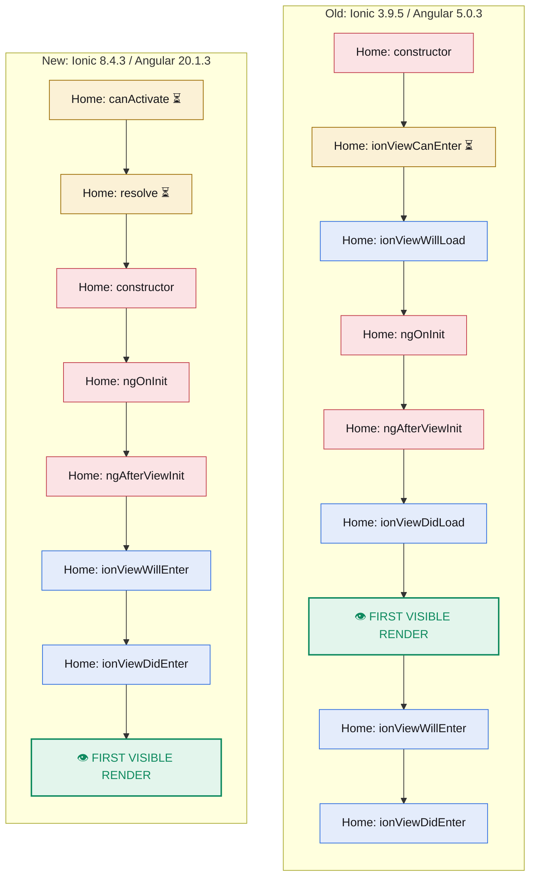
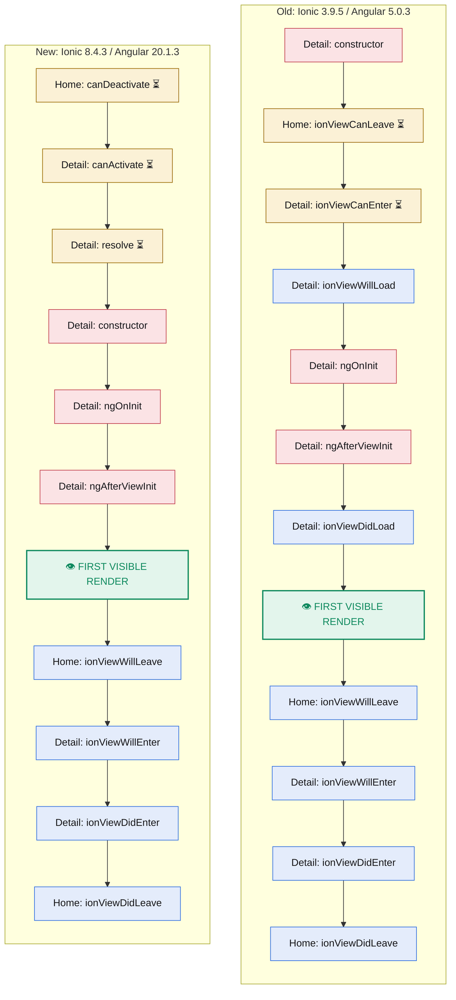
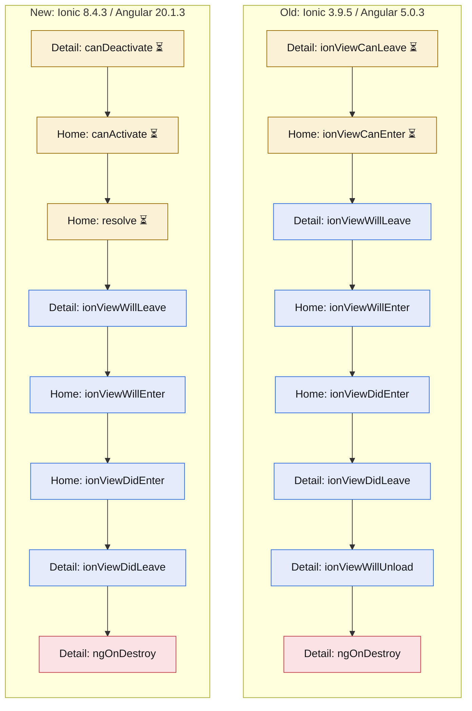
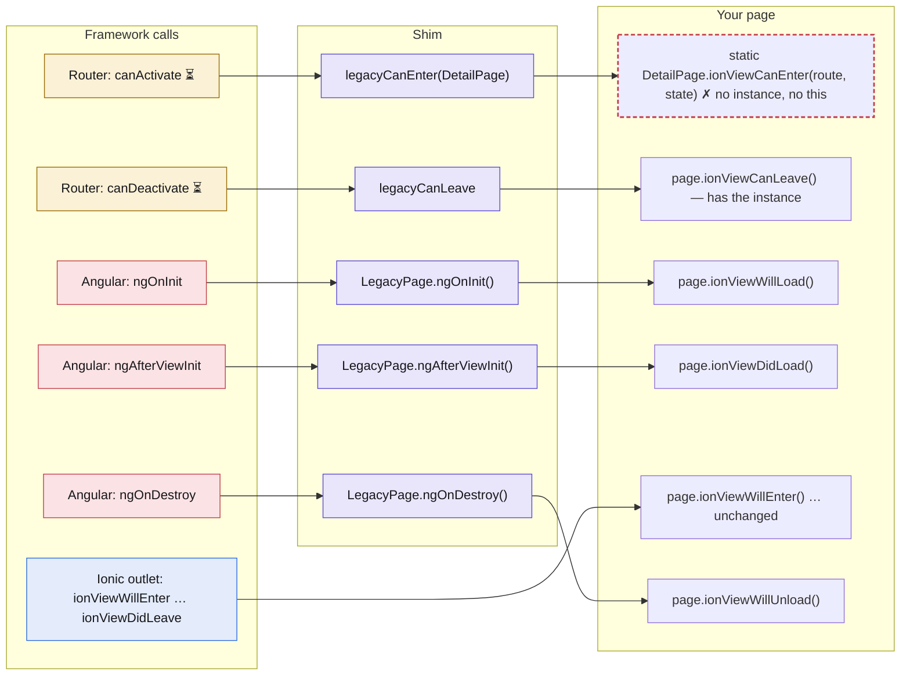
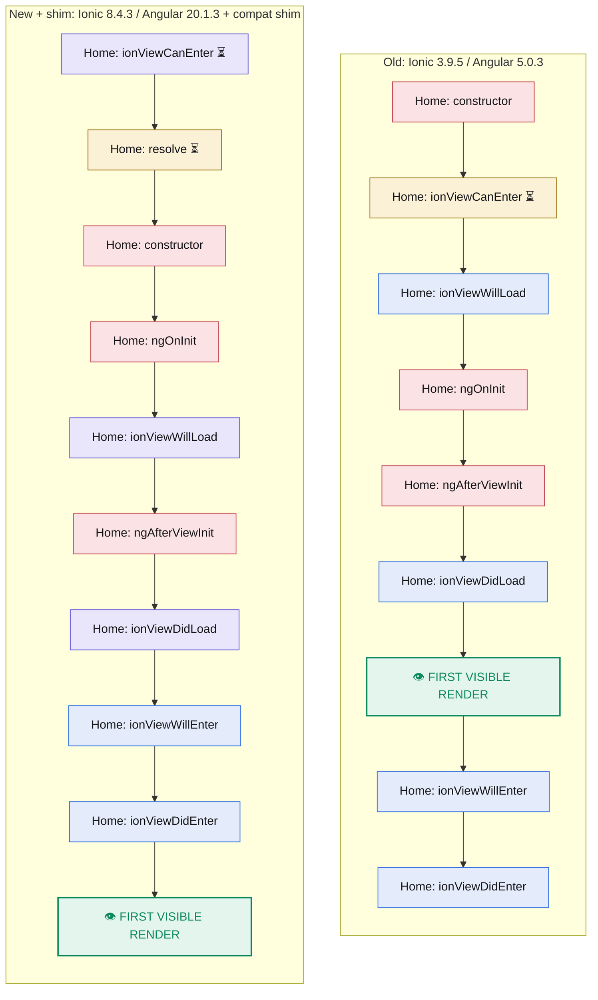
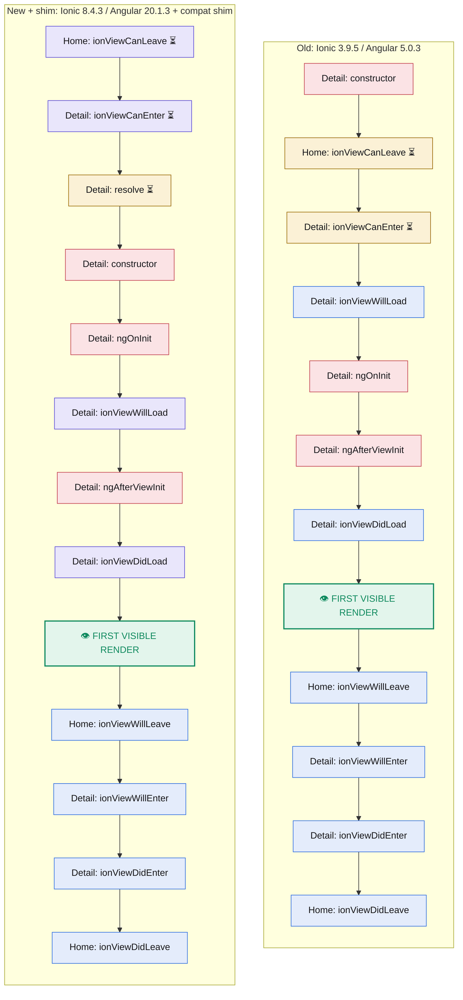
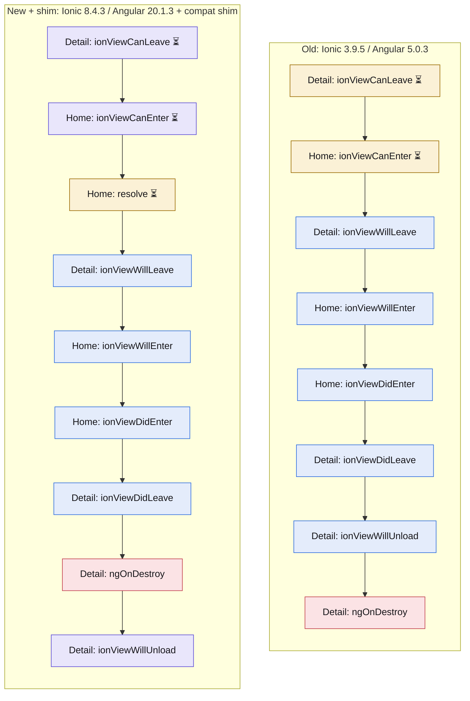

# Lifecycle order flowchart

The hooks a page author writes, in the order they fire, measured in two instrumented apps: **Ionic 3.9.5 / Angular 5.0.3** and **Ionic 8.4.3 / Angular 20.1.3**. Change-detection passes and router events are left out. Generated from `captures/` by `tools/generate.mjs`; do not edit by hand. Also available as a [PDF](lifecycle-flow.pdf) and as an interactive page ([lifecycle-flow.html](lifecycle-flow.html), open locally).

| Mark | Meaning |
|---|---|
| 🟥 red | Angular hook |
| 🟦 blue | Ionic page hook |
| 🟨 amber | Guard or resolver |
| 🟪 purple | Old hook re-created by the compat shim |
| 👁 green | First visible render: the page DOM is complete and the next frame shows it |
| ⏳ | The framework awaits what you return (Ionic 3: a Promise; the Angular router: a Promise or an Observable). Navigation pauses. Load or check data here. |
| ✗ dashed | Cannot be put back where Ionic 3 had it |

## 1. Old vs new

### App start



### Push Home → Detail



### Pop back to Home



### Where you can wait for data

Only the ⏳ hooks are awaited: Ionic 3 awaited a returned Promise, the Angular router awaits a Promise or an Observable. Everything else runs and the app moves on, so data loaded there needs its own loading state.

| You want to | Ionic 3 | Ionic 8 + Angular 20 | Page exists when it runs? |
|---|---|---|---|
| Block entering until data or permission is ready | `ionViewCanEnter` | `canActivate` for a yes/no, `resolve` for data; both await a Promise or Observable (`canMatch` too) | Old: yes, constructed first. New: no. |
| Block leaving (unsaved changes) | `ionViewCanLeave` | `canDeactivate` | Yes in both. |
| Show the page, then load | `ionViewDidLoad` or `ionViewWillEnter` | `ngOnInit` or `ionViewWillEnter`, not awaited | Yes in both. |
| Refresh every time the page is shown again | `ionViewWillEnter` | `ionViewWillEnter`, not awaited | Yes in both; the page is reused on pop. |

## 2. How the shim is called

Two route guards and one base class. The guards turn router calls into the old guard methods; the base class turns Angular hooks into the old load and unload hooks. The four enter and leave hooks need nothing: Ionic 8 still calls them by the same names.



**Route**

```ts
{
  path: 'detail',
  component: DetailPage,
  canActivate:   [legacyCanEnter(DetailPage)],
  canDeactivate: [legacyCanLeave],
}
```

**Guards**

```ts
export const legacyCanLeave: CanDeactivateFn<LegacyPage> =
  (page) => page?.ionViewCanLeave?.() ?? true;

export function legacyCanEnter(Page): CanActivateFn {
  return (route, state) =>
    Page.ionViewCanEnter ? Page.ionViewCanEnter(route, state) : true;
}
```

**Base class**

```ts
@Directive()
export abstract class LegacyPage {
  static ionViewCanEnter?(route, state): boolean | Promise<boolean>;

  ngOnInit()        { this.ionViewWillLoad(); }
  ngAfterViewInit() { this.ionViewDidLoad(); }
  ngOnDestroy()     { this.ionViewWillUnload(); }

  ionViewCanLeave(): boolean | Promise<boolean> { return true; }
  ionViewWillLoad() {}  ionViewDidLoad() {}  ionViewWillUnload() {}
}
```

**A page**

```ts
export class DetailPage extends LegacyPage {
  static override ionViewCanEnter(route, state) {
    return inject(AuthService).isAllowed();   // no this here
  }
  override ionViewCanLeave() { return !this.form.dirty; }
  override ionViewDidLoad()  { /* DOM exists, same as Ionic 3 */ }
}
```

The one thing that does not come back is an `ionViewCanEnter` that reads instance state. The router decides before the page exists, so the check has to be static or live in a service. If it must see the instance, let the guard pass and check in `ionViewWillEnter`, then navigate back; that restores "construct first, then decide" at the cost of a possible flash.

## 3. Old vs new with the shim

Same phases, with the shim wired in. A box without ✗ is in the same place as Ionic 3. Dashed ✗ boxes cannot be moved back; the reasons are listed under each diagram.

### App start



- ✗ `Home.ionViewCanEnter`: router runs it before the constructor.
- ✗ `Home.ionViewWillEnter`: root page: fires before the first paint.
- ✗ `Home.ionViewDidEnter`: root page: fires before the first paint.

### Push Home → Detail



- ✗ `Home.ionViewCanLeave`: router runs it before the next page is constructed.
- ✗ `Detail.ionViewCanEnter`: router runs it before the constructor.

### Pop back to Home



## First visible render

There is no "painted" event in either stack. The green box is the earliest point where the page DOM is complete and the next frame will show it: a `requestAnimationFrame` after `ngAfterViewInit` in the old app, `afterNextRender` in the new one. On a push the page then slides in and is fully visible at `ionViewDidEnter`. On app start the root page has nothing to leave, so Ionic 8 fires both enter hooks at once, before anything is painted.
